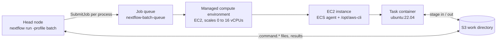
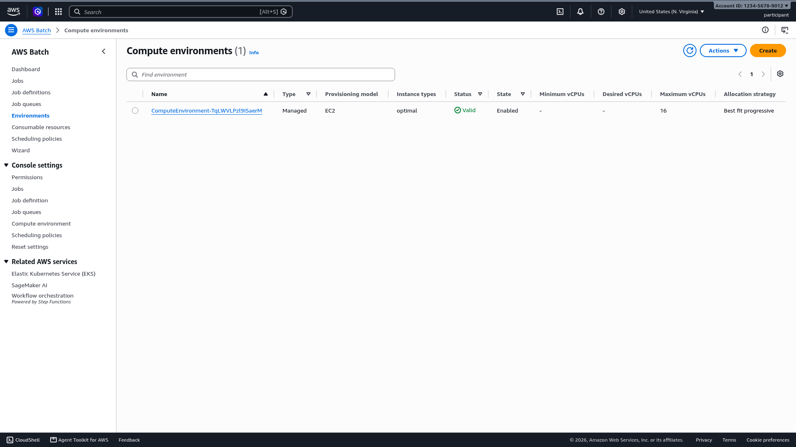
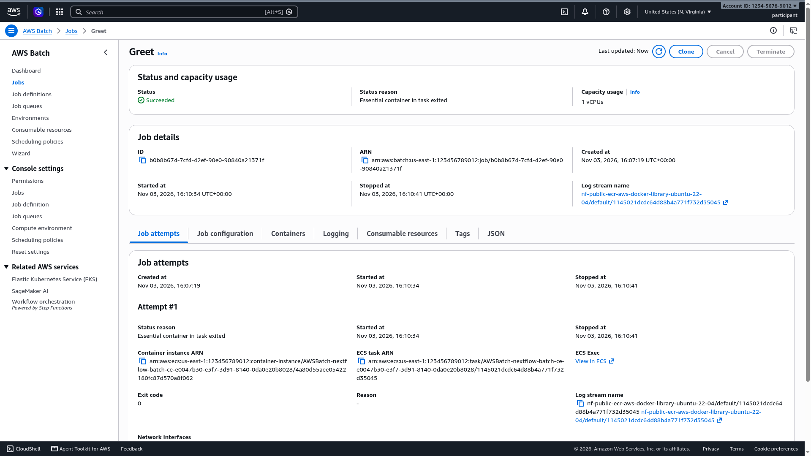

# Nextflow on AWS Batch: a 15-minute hands-on lab

Run a Nextflow pipeline on AWS Batch, from an empty account to a finished run, in one sitting. The lab is a companion to the [AWS HealthOmics: Modernizing Genomics from Storage to GenAI](https://catalog.us-east-1.prod.workshops.aws/workshops/6bff9693-78fe-4ab5-9695-0d85356f4d80/en-US) workshop: it reuses that workshop's GreetingsNF pipeline so you can compare the two execution engines side by side. It stands on its own, though; any AWS account with a default VPC works.

[한국어 가이드](docs/README.ko.md)

## Why Nextflow and AWS Batch fit together

Nextflow separates pipeline logic from the place it runs. A pipeline is a set of processes connected by channels; each process declares its inputs, outputs, resource needs (`cpus`, `memory`) and a container image. Where a process actually executes is decided by an *executor*, chosen in `nextflow.config`, so the same `main.nf` runs on a laptop, an HPC scheduler or a cloud service without edits. The executor moves inputs to the target, submits the task through that platform's API, watches it, and collects outputs.

AWS Batch is a managed service that runs containerized jobs at scale. You create a compute environment (which instance families, how many vCPUs at most, Spot or On-Demand) and a job queue in front of it. Jobs are ECS tasks, so every job is a container; Batch picks instance types to fit the jobs waiting in the queue, starts them, packs several containers per host when they fit, and scales back to zero when the queue is empty. There is no scheduler to install or cluster to keep warm.

The two match almost one to one. A Nextflow process becomes a Batch job; the process's container directive becomes the job's image; `cpus` and `memory` become the job's resource request, which is what Batch uses to choose an instance type. Nextflow also takes over the parts of Batch that are tedious by hand: it registers a job definition for every container image it meets and passes each task's CPU and memory as per-job overrides, stages inputs and outputs through the S3 work directory, retries failed tasks, and picks up IAM credentials from the environment. The Seqera engineering post [Nextflow and AWS Batch: Inside the Integration](https://seqera.io/blog/nextflow-and-aws-batch-inside-the-integration-part-1-of-3/) walks through this mapping in detail; the one cost it calls out, and that you will see in this lab, is start-up latency when the compute environment has to launch instances from zero.

## What you get

| File | Purpose |
|---|---|
| `main.nf` | GreetingsNF, a one-process Nextflow pipeline. Same file the HealthOmics workshop registers as a private workflow. Kept at the repository root so `nextflow run hmkim/nextflow-aws-batch-lab` works. |
| `cfn/batch-nextflow.yaml` | CloudFormation template: IAM instance role, EC2 launch template, managed compute environment (0 to 16 vCPUs), job queue. Optional Mountpoint for Amazon S3 mode. |
| `scripts/setup-nextflow-batch.sh` | One-shot, idempotent setup. Installs Java 17 and Nextflow 24.10, deploys the template, writes `nextflow.config`. |
| `pipeline/ref-check.nf` | Optional: reads a reference file through a Mountpoint for Amazon S3 mount instead of staging it. |
| `docs/` | Korean guide and console screenshots. |

## How it fits together

Nextflow itself (the "head node") runs wherever you launch it: a workshop IDE, your laptop, an EC2 instance. For every process it submits one AWS Batch job. Batch places the job on an EC2 instance from the compute environment, pulls the container image and runs the task script. Inputs are staged from Amazon S3 into the container and outputs written back to the S3 work directory, using an AWS CLI that the launch template installs on the instance and Nextflow mounts into the container.



Where you run the head node matters more than it looks. A laptop works, but the Nextflow process must stay alive for the whole run and keep its network connection. Running it on an EC2 instance or a cloud IDE, as this lab does, lets you close your laptop while a multi-hour pipeline continues. To detach a long run from the terminal, use Nextflow's own background flag rather than `nohup ... &` (Nextflow reads the terminal and a plain `&` job gets stopped):

```bash
nextflow -bg run main.nf -profile batch --addressee 'detached' -ansi-log false > run.log 2>&1
```

For unattended production runs, use `tmux` or a launcher such as Seqera Platform.

## Prerequisites

- An AWS account and a Linux shell with `sudo` (the script installs Java with `dnf`; on other distributions install Java 17 yourself and the script skips that step).
- A default VPC in the target region with public subnets. Private subnets with a NAT gateway also work; pass them as `SUBNET_IDS`.
- An S3 bucket for the Nextflow work directory. In the HealthOmics workshop account the script finds the `omics-output-*` bucket automatically; elsewhere set `WORK_BUCKET`.
- Credentials from the environment: an instance role, or an AWS CLI profile. Never put `aws.accessKey` / `aws.secretKey` in `nextflow.config`; the generated file has a comment to that effect.

Two permission levels are involved. **Setting up** (deploying the CloudFormation stack) creates IAM roles, a launch template and Batch resources, so it needs administrator-level access such as `PowerUserAccess` plus `IAMFullAccess`. **Running pipelines** afterwards needs much less: the policy below, taken from the [Seqera `awsbatch` executor reference](https://docs.seqera.io/nextflow/reference/executor/aws-batch/), is enough for the head node.

<details>
<summary>Minimum IAM policy for the Nextflow head node</summary>

```json
{
  "Version": "2012-10-17",
  "Statement": [
    {
      "Sid": "BatchJobs",
      "Effect": "Allow",
      "Action": [
        "batch:CancelJob",
        "batch:DescribeComputeEnvironments",
        "batch:DescribeJobDefinitions",
        "batch:DescribeJobQueues",
        "batch:DescribeJobs",
        "batch:ListJobs",
        "batch:RegisterJobDefinition",
        "batch:SubmitJob",
        "batch:TagResource",
        "batch:TerminateJob"
      ],
      "Resource": "*"
    },
    {
      "Sid": "InspectInstances",
      "Effect": "Allow",
      "Action": [
        "ec2:DescribeInstanceAttribute",
        "ec2:DescribeInstances",
        "ec2:DescribeInstanceStatus",
        "ec2:DescribeInstanceTypes",
        "ecs:DescribeContainerInstances",
        "ecs:DescribeTasks"
      ],
      "Resource": "*"
    },
    {
      "Sid": "WorkDirectory",
      "Effect": "Allow",
      "Action": [
        "s3:ListBucket",
        "s3:GetBucketLocation",
        "s3:GetObject",
        "s3:PutObject",
        "s3:DeleteObject",
        "s3:AbortMultipartUpload",
        "s3:ListMultipartUploadParts"
      ],
      "Resource": [
        "arn:aws:s3:::WORK_BUCKET",
        "arn:aws:s3:::WORK_BUCKET/*"
      ]
    }
  ]
}
```

Replace `WORK_BUCKET`. Add `AmazonEC2ContainerRegistryReadOnly` if your container images live in a private ECR repository. The compute instances have their own role, created by the stack.

</details>

Measured on the workshop IDE (Amazon Linux 2023, `m8i.large`): setup 3 min 13 s, first run 3 min 41 s, second run 35 s.

## Step 1: Set up the environment

Clone the repository and run the setup script. Every step is idempotent; if it stops part way, run it again.

```bash
git clone https://github.com/hmkim/nextflow-aws-batch-lab.git
cd nextflow-aws-batch-lab
bash scripts/setup-nextflow-batch.sh
```

Outside the workshop account, name the work bucket first:

```bash
WORK_BUCKET=my-nextflow-work-bucket bash scripts/setup-nextflow-batch.sh
```

The script prints one section per step. The CloudFormation step is the slow one, about three minutes:

```
==> 1/5 Installing Java 17 and Nextflow
    Installed openjdk version "17.0.21" 2026-10-20 LTS
    Installed version 24.10.5 build 5935
==> 2/5 Discovering region, VPC and buckets
    Region      : us-east-1
    Account     : 123456789012
    VPC         : vpc-0a21c17c0f1e85d1d
    Subnets     : subnet-0a6f4d9593a8b8ddd,subnet-07de34ad336485c76,...
    Work bucket : s3://omics-output-us-east-1-123456789012
==> 3/5 Deploying AWS Batch stack 'nextflow-batch' (3-5 minutes)
Successfully created/updated stack - nextflow-batch
    Job queue   : nextflow-batch-queue
==> 4/5 Writing nextflow.config
    profile 'batch' -> queue nextflow-batch-queue, workDir s3://.../nextflow-batch/work
==> 5/5 Preparing the GreetingsNF pipeline

Setup complete. Next:

    nextflow run main.nf -profile batch --addressee 'AWS Batch'
```

<details>
<summary><b>Prefer to do it by hand?</b> The five steps the script performs.</summary>

**1. Install Java and Nextflow.** Nextflow 24.10 is the release line AWS HealthOmics runs. Nextflow 25 and later enable a stricter parser that rejects the top-level `if (...) exit 1` guard in `main.nf`, so the version matters. (`curl -s https://get.nextflow.io | bash` installs the latest release and would hit that error.)

```bash
sudo dnf install -y java-17-amazon-corretto-headless
mkdir -p ~/.local/bin
curl -fsSL https://github.com/nextflow-io/nextflow/releases/download/v24.10.5/nextflow-24.10.5-dist \
  -o ~/.local/bin/nextflow
chmod +x ~/.local/bin/nextflow
nextflow -version
```

**2. Discover the account settings.**

```bash
export AWS_REGION=us-east-1
export VPC_ID=$(aws ec2 describe-vpcs --filters Name=is-default,Values=true \
  --query 'Vpcs[0].VpcId' --output text)
export SUBNET_IDS=$(aws ec2 describe-subnets \
  --filters Name=vpc-id,Values="$VPC_ID" Name=default-for-az,Values=true \
  --query 'Subnets[].SubnetId' --output text | tr '\t' ',')
export WORK_BUCKET=my-nextflow-work-bucket
```

**3. Deploy the CloudFormation stack.** The subnet list contains commas, so the parameters go in a JSON file.

```bash
cat > .stack-parameters.json <<EOF
[
  {"ParameterKey": "VpcId",      "ParameterValue": "$VPC_ID"},
  {"ParameterKey": "SubnetIds",  "ParameterValue": "$SUBNET_IDS"},
  {"ParameterKey": "WorkBucket", "ParameterValue": "$WORK_BUCKET"}
]
EOF

aws cloudformation deploy \
  --stack-name nextflow-batch \
  --template-file cfn/batch-nextflow.yaml \
  --parameter-overrides file://.stack-parameters.json \
  --capabilities CAPABILITY_IAM
```

**4. Write `nextflow.config`.** The `batch` profile submits processes to the queue, keeps intermediate files in S3 and uses the AWS CLI the launch template installed on each instance. Credentials are not in this file; Nextflow takes them from the instance role or your AWS CLI profile.

```groovy
profiles {
    batch {
        process {
            executor  = 'awsbatch'
            queue     = 'nextflow-batch-queue'
            container = 'public.ecr.aws/docker/library/ubuntu:22.04'
        }
        workDir = 's3://my-nextflow-work-bucket/nextflow-batch/work'
        aws {
            region = 'us-east-1'
            batch {
                cliPath = '/opt/aws-cli/bin/aws'
                maxParallelTransfers = 4
            }
        }
    }
}
```

Two rules from the executor reference are already satisfied here: every process has a `container` (set once at profile level), and `workDir` is a sub-path, not a bare bucket.

**5. Prepare the pipeline.** `main.nf` publishes to `/mnt/workflow/pubdir`, the HealthOmics output path, so the same file runs on both engines.

```bash
sudo mkdir -p /mnt/workflow/pubdir
sudo chown "$(id -u):$(id -g)" /mnt/workflow/pubdir
```

</details>

### What the stack creates

| Resource | Purpose |
|---|---|
| IAM role and instance profile | Compute instances run as this role: ECS agent policy plus read/write on the work bucket, so tasks stage files without extra credentials. |
| Launch template | User data installs a self-contained AWS CLI under `/opt/aws-cli`. It is a conda environment (Miniforge plus the `awscli` package), not the AWS CLI v2 installer: the v2 build depends on host libraries such as `libz` that minimal images (biocontainers, for example) do not ship, while the conda build carries every library it needs inside `/opt/aws-cli`. Nextflow mounts the *grandparent* directory of `cliPath` into every task container at the same path, so `/opt/aws-cli/bin/aws` mounts `/opt/aws-cli` and nothing else. Keep it that way: a path such as `/usr/local/bin/aws` would shadow the container's whole `/usr/local`. |
| Compute environment | Managed, EC2, `optimal` instance types, 0 to 16 vCPUs. Batch launches instances when jobs arrive and terminates them after a few idle minutes. |
| Job queue | `nextflow-batch-queue`, the name the Nextflow profile submits to. |

Confirm the queue is attached to a valid, idle compute environment:

```bash
aws batch describe-job-queues --job-queues nextflow-batch-queue \
  --query 'jobQueues[0].[jobQueueName,state,status]' --output text
aws batch describe-compute-environments \
  --query 'computeEnvironments[].[computeEnvironmentName,state,status,computeResources.desiredvCpus]' \
  --output table
```

```
nextflow-batch-queue    ENABLED VALID
|  nextflow-batch-ce-lt1 |  ENABLED |  VALID |  0   |
```



## Step 2: Run the pipeline

Selecting the profile is the only change from a local or HealthOmics run.

```bash
nextflow run main.nf -profile batch --addressee 'AWS Batch' -with-trace
```

```
 N E X T F L O W   ~  version 24.10.5
Launching `main.nf` [reverent_williams] DSL2 - revision: d6e8fbf8eb
executor >  awsbatch (1)
[eb/a44df8] Greet | 0 of 1
```

The task runs in milliseconds; almost all of the wall time is Batch launching the first EC2 instance into an empty compute environment. While it waits, open the [Jobs page of the AWS Batch console](https://console.aws.amazon.com/batch/home#jobs), pick `nextflow-batch-queue` and click **Search**.


Each Nextflow process is one Batch job named after the process. It moves through `RUNNABLE` (waiting for capacity), `STARTING` (instance registered, image pulling) and `RUNNING`. In the screenshot the first `Greet` job was created at 16:07:19 and started at 16:10:34: three minutes waiting for the instance, seven seconds of work. The second job, submitted while the instance was alive, started five seconds after creation.

Click the job name for the detail page.



The log stream name starts with `nf-public-ecr-aws-docker-library-ubuntu-22-04`: the job definition Nextflow registered for the container image in the profile. The ECS task and container instance ARNs show Batch running the job as an ECS task on the compute environment's instance. Open the **Job configuration** tab and look at the command: it is not your script but a single `bash -o pipefail -c "... .command.run"`. Nextflow sends every task as the same wrapper, which downloads `.command.sh` from S3, runs it, and uploads the outputs. The **Logging** tab holds the task's stdout, the same content Nextflow copies to `.command.log`.

### Confirm the result

```
[eb/a44df8] Greet | 1 of 1 ✔
Completed at: 03-Nov-2026 16:10:58
Duration    : 3m 41s
Succeeded   : 1
```

```bash
cat /mnt/workflow/pubdir/output
# hello AWS Batch

aws s3 ls --recursive s3://$WORK_BUCKET/nextflow-batch/work/
```

```
16:07:19      12769 .../eb/a44df8.../.command.run
16:07:19         52 .../eb/a44df8.../.command.sh
16:10:36          6 .../eb/a44df8.../.command.begin
16:10:39         16 .../eb/a44df8.../.command.out
16:10:41          1 .../eb/a44df8.../.exitcode
16:10:41         16 .../eb/a44df8.../output
```

`.command.sh` is your process script, `.command.run` the wrapper Nextflow generated to stage files with the AWS CLI, `.command.begin` the moment the container started. The three-minute gap between `.command.run` (uploaded at submission) and `.command.begin` is the instance launch. The trace file says the same per task:

```bash
cut -f4,6,7,8,9 trace-*.txt | column -t
# name   exit  submit                   duration  realtime
# Greet  0     2026-11-03 16:07:19.268  3m 29s    4ms
```

Now look at what Nextflow registered in Batch on your behalf:

```bash
aws batch describe-job-definitions --status ACTIVE \
  --query 'jobDefinitions[].[jobDefinitionName,revision,containerProperties.image,containerProperties.resourceRequirements]' \
  --output table
```

One job definition, `nf-public-ecr-aws-docker-library-ubuntu-22-04`, named after the profile's image, with a placeholder request of 1 vCPU and 1 GiB. Nextflow creates one definition per container image (plus container-level settings such as mounted volumes; enabling the Mountpoint mode later adds a revision) and reuses it across runs. The real CPU and memory of each task are not in the definition: Nextflow passes them as per-job overrides at submit time, which is what the next experiment shows. A pipeline with ten processes in three images ends up with three definitions, created on first use; you never write one.

The same stdout is also in CloudWatch Logs, in the `/aws/batch/job` log group, one stream per job. The stream is what the **Logging** tab displays. Log storage is billed, so set a retention period on that group once you run real volumes:

```bash
aws logs put-retention-policy --log-group-name /aws/batch/job --retention-in-days 30
```

### Run it again

```bash
nextflow run main.nf -profile batch --addressee 'warm run'
```

```
[6c/6541a3] Greet | 1 of 1 ✔
Duration    : 35s
```

The difference between 3m 41s and 35s is the cost of scaling from zero. In production you trade it against idle cost with a minimum vCPU count on the compute environment, or accept the delay for infrequent pipelines.

### Try it: change the resource request without touching the pipeline

`cpus` and `memory` are what Batch uses to pick an instance. The pipeline sets neither, so the task asked for the default 1 vCPU / 1 GiB and Batch picked a `c6i.large`. Override them from a second configuration file, scoped to the one process, and run again. `-c` layers the file on top of `nextflow.config`, so the profile is untouched:

```bash
cat > resources.config <<'EOF'
process {
    withName: 'Greet' {
        cpus   = 4
        memory = '8 GB'
    }
}
EOF

nextflow run main.nf -profile batch -c resources.config --addressee 'bigger'
```

Open the new job in the console. **Capacity usage** reads 4 vCPUs, and `describe-jobs` shows the request Nextflow sent as a container override on the same job definition revision as before:

```bash
JOB=$(aws batch list-jobs --job-queue nextflow-batch-queue --job-status SUCCEEDED \
  --query "sort_by(jobSummaryList,&createdAt)[-1].jobId" --output text)
aws batch describe-jobs --jobs $JOB \
  --query 'jobs[0].[jobDefinition,container.resourceRequirements]' --output text
# ...job-definition/nf-public-ecr-aws-docker-library-ubuntu-22-04:1
# 8192    MEMORY
# 4       VCPU
```

Batch answered the request with an `m6i.xlarge` (4 vCPUs, 16 GiB) instead of the `c6i.large` it chose for the 1-vCPU task; `optimal` means "the cheapest instance that fits the waiting jobs". The job definition list did not grow. `main.nf` did not change either. This is the handle you turn when a real task needs 32 GiB: the pipeline stays portable and the configuration carries the sizing.

### Run straight from GitHub

Nextflow can fetch a pipeline from a Git repository instead of a local directory. Because `main.nf` is at this repository's root, the following works from any machine with Nextflow and the `nextflow.config` the setup script wrote:

```bash
nextflow -C nextflow.config run hmkim/nextflow-aws-batch-lab -profile batch --addressee 'from GitHub'
```

Nextflow clones the repository into `~/.nextflow/assets/`, runs it, and reports the commit it used in the `revision:` line. Pin a version with `-r <tag-or-commit>`. This is how teams distribute pipelines (nf-core works the same way); the config file stays local because it names your queue and bucket.

### Ask Kiro to explain the run

If the Kiro CLI is installed and signed in, hand it the logs:

```bash
kiro-cli chat --no-interactive --trust-tools=fs_read,execute_bash \
  "Read nextflow.config, .nextflow.log and trace-*.txt in the current directory. In under 150 words, \
tell me which AWS Batch job queue and container image the Greet task used, how long the task waited \
between submission and start, and why. Then run \
'aws batch describe-compute-environments --query computeEnvironments[].computeResources.desiredvCpus' \
and report the value."
```

In testing Kiro reported the queue and image from the profile, a 195-second wait between `createdAt` and `startedAt`, explained it as the compute environment scaling from zero, and reported `desiredvCpus` of `[0]` because the instance had already been released.

## HealthOmics and AWS Batch side by side

| | AWS HealthOmics | AWS Batch (this lab) |
|---|---|---|
| What you set up | Workflow definition and an IAM role | IAM role, launch template, compute environment, job queue, Nextflow head node |
| How a run starts | `aws omics start-run`; the service runs the head node | `nextflow run -profile batch` on a machine you manage |
| Compute | Chosen per task by the service | Your compute environment: instance families, min/max vCPUs, Spot or On-Demand, custom AMIs |
| Container images | Amazon ECR in your account | Any registry the instances reach (ECR, ECR Public, Docker Hub) |
| Data staging | Service-managed shared file system | Nextflow stages per task from S3 with the AWS CLI on the instance |
| First-task latency measured | About 1 to 2 minutes | 3m 29s cold, 5 s warm |
| Logs | CloudWatch, grouped per run | One CloudWatch stream per job in `/aws/batch/job`, plus `.command.*` in S3 |
| What you operate | Nothing between runs | Capacity, AMI updates, head node, work directory lifecycle |

Neither is "better". HealthOmics removes the operational surface and bills per run; Batch exposes every knob and fits when a pipeline needs hardware or software the service does not provide, or when the rest of your platform already runs there. The same `main.nf` targets either one.

## Production notes

The lab keeps every setting at its simplest. These are the first things to change for real workloads; each is a configuration or template change, not a pipeline change.

**Spot Instances.** Create a second compute environment with the `SPOT` provisioning model (in the template, `Type: SPOT` plus `SpotIamFleetRole` is not required for the `BEST_FIT_PROGRESSIVE` strategy; `SPOT_PRICE_CAPACITY_OPTIMIZED` is the recommended allocation strategy) and bind it to the queue. Spot capacity can be reclaimed mid-task, so let Batch retry those jobs:

```groovy
aws.batch.maxSpotAttempts = 3
```

Batch retries only Spot reclamations. Other failures are Nextflow's job; a common pattern is to retry the exit codes that mean "killed from outside" (130, 137, 143, 151, which cover SIGINT, OOM-kill, SIGTERM and Spot interruption) and stop on anything else:

```groovy
process {
    errorStrategy = { task.exitStatus in [130, 137, 143, 151] ? 'retry' : 'finish' }
    maxRetries    = 3
}
```

**Size tasks explicitly.** Give every process `cpus` and `memory` (see the experiment above). Batch packs containers onto hosts by these numbers; an unsized task gets 1 vCPU / 1 GiB and either starves or wastes the instance.

**Tag jobs for cost allocation.** `resourceLabels` become AWS tags on each job, and with cost allocation tags enabled they show up in Cost Explorer:

```groovy
process.resourceLabels = [ project: 'genomics-lab', owner: 'team-a' ]
```

**Keep a warm floor when latency matters.** `MinvCpus: 2` on the compute environment keeps one small instance running and removes the three-minute cold start, at the price of that instance's idle time.

**Mount host paths when tasks need them.** `aws.batch.volumes` bind-mounts host directories into every task container, with the usual Docker `host:container:mode` syntax. The Mountpoint section below uses it; the full option is documented under [Volume mounts](https://docs.seqera.io/nextflow/reference/executor/aws-batch/#volume-mounts) in the executor reference.

**Consider Wave and Fusion.** Seqera's recommended way to run on Batch today is to let Wave build the container with the Fusion file system inside, so tasks read and write S3 directly and no AWS CLI is needed on the AMI or in the image. This lab deliberately uses the plain AWS CLI path instead: it has no dependency on an external service, works in restricted networks, and keeps the staging mechanism visible in `.command.run`. When you outgrow it, the switch is `wave.enabled = true` and `fusion.enabled = true` in the profile and dropping `cliPath`.

## Going further: stream reference data with Mountpoint for Amazon S3

Pipelines with large static reference files (a VEP cache, a reference genome and its indexes) spend much of their time copying the same files into every task. The AWS HPC Blog post [Optimize Nextflow workflows on AWS Batch with Mountpoint for Amazon S3](https://aws.amazon.com/blogs/hpc/optimize-nextflow-workflows-on-aws-batch-with-mountpoint-for-amazon-s3/) shows how Genomics England avoided this for a 500 GB VEP cache by mounting the bucket on each compute instance.

The template supports the pattern. Re-run the setup with a data bucket and the mount flag:

```bash
DATA_BUCKET=my-reference-bucket MOUNT_DATA_BUCKET=true bash scripts/setup-nextflow-batch.sh
```

This adds Mountpoint for Amazon S3 to the launch template, mounts the bucket read-only at `/mnt/s3-ref` on every instance (the compute environment is replaced, about two minutes), and adds `aws.batch.volumes = '/mnt/s3-ref:/mnt/s3-ref:ro'` to the profile so the mount is visible inside task containers.

`pipeline/ref-check.nf` shows the one rule that matters: pass the mounted directory as a `val` input and read files from it in the script.

```groovy
process REF_SUMMARY {
    input:
        val ref_dir            // '/mnt/s3-ref/reference', NOT a path input
    script:
        """
        grep -vc '^#' ${ref_dir}/sample.gff3
        """
}
```

```bash
aws s3 cp sample.gff3 s3://my-reference-bucket/reference/sample.gff3
nextflow run pipeline/ref-check.nf -profile batch
```

Passing the same directory as a `path` input fails with `Can't stage file /mnt/s3-ref/... -- file does not exist`, because the head node tries to stage a file only the compute instances can see. The post calls this out; the lab reproduces it on purpose.

## Optional: run a real nf-core pipeline

GreetingsNF shows the mechanics but not the scheduling. The [nf-core](https://nf-co.re/) community pipelines do: dozens of processes, several container images, fan-out over samples and fan-in for reports. Every nf-core pipeline ships a `test` profile that points at a tiny public dataset and caps resources (4 CPUs, 15 GB, 1 hour per task), so it runs on the compute environment you already have. Nothing about the Batch side changes; you add `test` to the profile list and give an output location.

Two pipelines are worth trying. [nf-core/rnaseq](https://nf-co.re/rnaseq) is bulk RNA-seq quantification (trimming, STAR or Salmon alignment, counting, QC). [nf-core/sarek](https://nf-co.re/sarek) is germline and somatic variant calling, the same class of workflow the HealthOmics GATK module runs. On the 16-vCPU compute environment from this lab, the sarek test took about 15 minutes (23 tasks) and the rnaseq test 18 minutes (209 tasks, 5 samples), most of it in instance start-up and container pulls. Start one and read the rest of this page while it runs.

The lab pins Nextflow 24.10.5. The current nf-core releases require Nextflow 25.10 or later, so the commands below pin the last releases that run on 24.10: rnaseq `3.19.0` and sarek `3.5.1`. The note at the end shows how to run the latest releases.

### rnaseq

```bash
export WORK_BUCKET=$(aws s3api list-buckets \
  --query "Buckets[?starts_with(Name, 'omics-output-')].Name | [0]" --output text)

nextflow run nf-core/rnaseq -r 3.19.0 -profile test,batch \
  --outdir s3://$WORK_BUCKET/nextflow-batch/rnaseq-test \
  -with-trace trace-rnaseq.txt
```

Nextflow clones the pipeline into `~/.nextflow/assets/`, prints the parameter summary, and starts submitting. The Batch console fills up with jobs named after nf-core modules (`NFCORE_RNASEQ:RNASEQ:FASTQ_QC_TRIM_FILTER_SETSTRANDEDNESS:...:FASTQC`, `...:ALIGN_STAR:STAR_ALIGN`, `...:MULTIQC`). Several run at once because the test samplesheet has five samples; watch **Environments** to see the compute environment climb to its 16-vCPU ceiling (four `xlarge` instances when this was tested) and shrink back to zero afterwards.

The outputs land in `s3://$WORK_BUCKET/nextflow-batch/rnaseq-test/`, including `multiqc/star_salmon/multiqc_report.html`. Download it and open it in a browser:

```bash
aws s3 cp s3://$WORK_BUCKET/nextflow-batch/rnaseq-test/multiqc/star_salmon/multiqc_report.html .
```

### sarek

```bash
nextflow run nf-core/sarek -r 3.5.1 -profile test,batch \
  --outdir s3://$WORK_BUCKET/nextflow-batch/sarek-test \
  -with-trace trace-sarek.txt
```

The test profile runs a single-sample germline workflow on a small reference: BWA index and alignment, duplicate marking, base recalibration, and variant calling with Strelka. The VCFs land under `sarek-test/variant_calling/strelka/test/` and the report under `sarek-test/multiqc/multiqc_report.html`. Compare its task list with the GATK run from the HealthOmics workshop; the steps are the same family, the engine is different.

### What to look at afterwards

The trace file is where a real pipeline becomes interesting. `duration` is the time from submission to completion, `realtime` the time the script itself ran, so the gap between them is queueing plus container pull:

```bash
awk -F'\t' 'NR>1 {print $8"\t"$9"\t"$4}' trace-rnaseq.txt | column -t -s$'\t' | less -S
```

Most tasks ran for a few seconds but took around a minute end to end; the first task on each new instance paid for the instance launch and the image pull, and tasks submitted while an instance was free started in seconds. Count the processes to see the fan-out: `SALMON_QUANT`, `STRINGTIE` and `FEATURECOUNTS` each ran five times, once per sample.

```bash
awk -F'\t' 'NR>1 {print $4}' trace-rnaseq.txt | sed 's/ (.*//' | sort | uniq -c | sort -rn | head
```

`aws batch describe-job-definitions --status ACTIVE` now lists one definition per container image the two pipelines used (38 after both test runs), created on first use, exactly as described above. If a run fails part way, add `-resume` to the same command and Nextflow skips every task whose outputs are already in the S3 work directory.

### Running the latest nf-core releases

Current nf-core releases need a newer Nextflow than the 24.10.5 this lab installs. Nextflow's standard launcher can run any version on demand through the `NXF_VER` variable, so install it alongside the pinned binary rather than replacing it:

```bash
curl -s https://get.nextflow.io -o ~/.local/bin/nextflow-launcher
chmod +x ~/.local/bin/nextflow-launcher

NXF_VER=25.10.4 nextflow-launcher run nf-core/rnaseq -r 3.27.0 -profile test,batch \
  --outdir s3://$WORK_BUCKET/nextflow-batch/rnaseq-test-latest
```

The first call downloads that Nextflow version into `~/.nextflow/`. `nextflow.config` and the Batch environment are shared, so nothing else changes. When this was tested, rnaseq 3.27.0 on Nextflow 25.10.4 completed its 234 tasks in 21 min 40 s on the same compute environment. Leave the pinned `nextflow` in place for GreetingsNF; its `main.nf` uses syntax the newer strict parser rejects.

### Clean up the test outputs

```bash
aws s3 rm --recursive s3://$WORK_BUCKET/nextflow-batch/rnaseq-test/
aws s3 rm --recursive s3://$WORK_BUCKET/nextflow-batch/sarek-test/
```

The work directory under `nextflow-batch/work/` is removed by the main cleanup step below.

## Clean up

```bash
aws cloudformation delete-stack --stack-name nextflow-batch
aws s3 rm --recursive s3://$WORK_BUCKET/nextflow-batch/
aws cloudformation wait stack-delete-complete --stack-name nextflow-batch
```

Deleting the compute environment terminates any remaining instance, so the wait can take a few minutes. The stack owns the IAM role, launch template, compute environment and job queue; nothing else is left behind. Job definitions registered by Nextflow are not part of the stack; they cost nothing, but `aws batch deregister-job-definition --job-definition <name>:<revision>` removes them if you want a clean account.

## Troubleshooting

| Symptom | Cause and fix |
|---|---|
| `Statements cannot be mixed with script declarations` at `main.nf:6` | Nextflow 25+ strict parser. Use 24.10.x (the script pins 24.10.5) or move the guard into the `workflow` block. |
| `JobQueue <queue> not found` | `aws.region` in the profile does not match the region where the stack was deployed. |
| Job stays `RUNNABLE` for more than 10 minutes | Compute environment cannot launch: check the EC2 vCPU quota, that subnets auto-assign public IPs (or have a NAT route), and the compute environment's status reason in the console. AWS keeps a [checklist for stuck RUNNABLE jobs](https://docs.aws.amazon.com/batch/latest/userguide/troubleshooting.html#job_stuck_in_runnable). |
| `Process <task> terminated for an unknown reason -- Likely it has been terminated by the external system` | Batch could not run the launcher. Usually a container image with a non-standard `ENTRYPOINT` that is not a shell, or the AWS CLI on the instance not executing. Check the job's **Logging** tab and `/aws/batch/job` in CloudWatch. |
| `CloudFormation cannot update a stack when a custom-named resource requires replacing` | You changed the launch template on an older template version. The current template names the compute environment with the launch-template version so it can be replaced. |
| Task fails with `aws: command not found` | `aws.batch.cliPath` does not match where the launch template installed the CLI (`/opt/aws-cli/bin/aws`). |
| Task exits 127 with `/opt/aws-cli/bin/aws: error while loading shared libraries: libz.so.1` | The CLI on the instance is the AWS CLI v2 installer build, which needs host libraries the task image lacks. Deploy the current template, which installs a conda-based CLI with its own libraries; the GreetingsNF `ubuntu` image hides this problem, biocontainers images expose it. |
| `Can't stage file /mnt/s3-ref/...` | Mounted directory passed as `path`; pass it as `val`. |

Where to look, in order: `.nextflow.log` on the head node, the job's detail page in the Batch console, and the `/aws/batch/job` log group in CloudWatch.

## License

MIT-0. See `LICENSE`.
