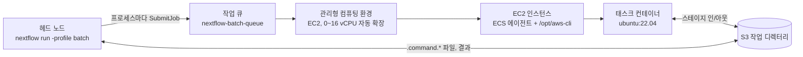
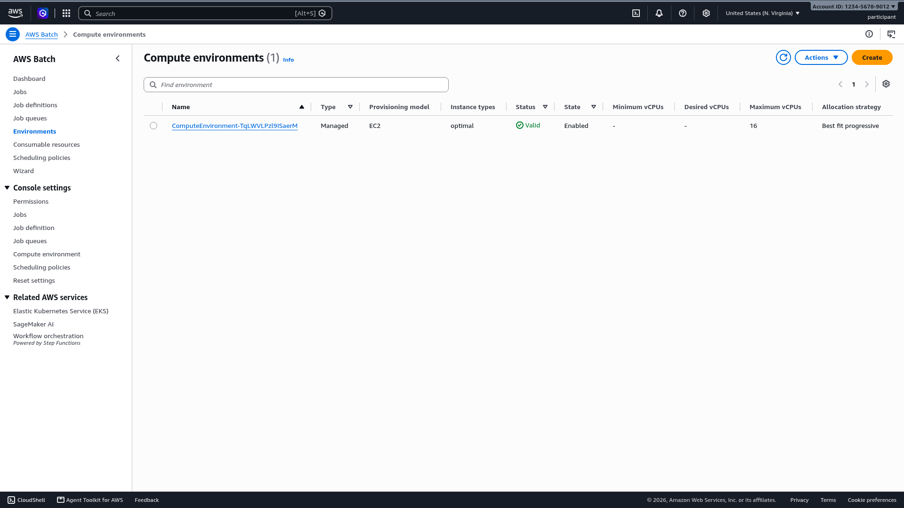
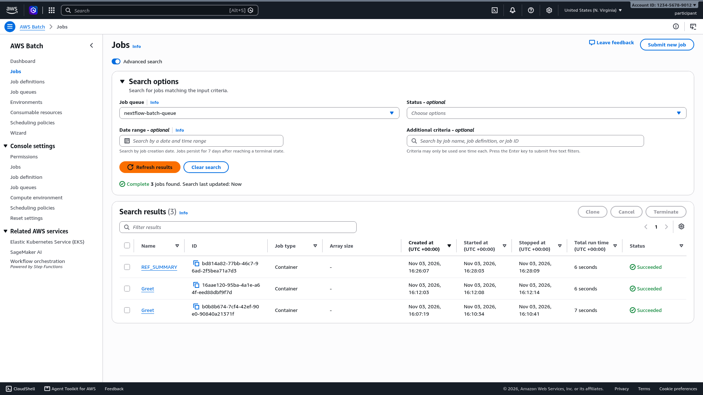
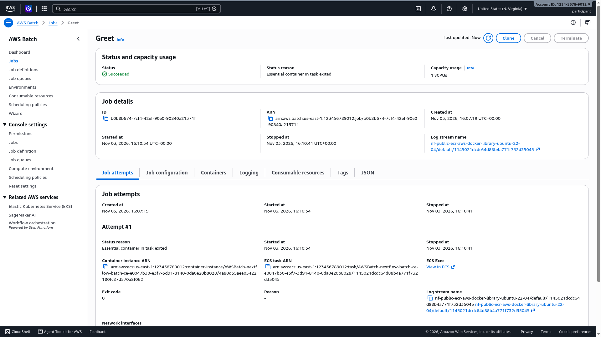

# AWS Batch에서 Nextflow 실행: 15분 핸즈온 랩

빈 계정에서 시작해 Nextflow 파이프라인을 AWS Batch에서 끝까지 한 번 실행합니다. [AWS HealthOmics: Modernizing Genomics from Storage to GenAI](https://catalog.us-east-1.prod.workshops.aws/workshops/6bff9693-78fe-4ab5-9695-0d85356f4d80/en-US) 워크숍의 자매 랩으로, 그 워크숍의 GreetingsNF 파이프라인을 그대로 가져와 두 실행 엔진을 나란히 비교할 수 있게 했습니다. 단독으로도 동작하며, 기본 VPC가 있는 AWS 계정이면 어디서든 됩니다.

[English guide](../README.md)

## Nextflow와 AWS Batch가 잘 맞는 이유

Nextflow는 파이프라인 로직과 실행 장소를 분리합니다. 파이프라인은 채널로 연결된 프로세스들의 집합이고, 각 프로세스는 입력, 출력, 자원 요구량(`cpus`, `memory`), 컨테이너 이미지를 선언합니다. 프로세스가 실제로 어디서 실행되는지는 `nextflow.config`에서 고른 *실행기(executor)*가 결정하므로, 같은 `main.nf`가 노트북, HPC 스케줄러, 클라우드 서비스에서 수정 없이 돌아갑니다. 실행기는 입력을 대상 환경으로 옮기고, 그 플랫폼의 API로 태스크를 제출하고, 상태를 지켜보고, 출력을 회수합니다.

AWS Batch는 컨테이너 작업을 대규모로 실행하는 관리형 서비스입니다. 컴퓨팅 환경(어떤 인스턴스 패밀리를, 최대 몇 vCPU까지, 스팟인지 온디맨드인지)과 그 앞의 작업 큐를 만들어 두면 됩니다. 작업은 ECS 태스크이므로 모든 작업이 컨테이너입니다. Batch는 큐에서 대기 중인 작업에 맞는 인스턴스 유형을 골라 띄우고, 들어가는 만큼 한 호스트에 여러 컨테이너를 채우고, 큐가 비면 0으로 축소합니다. 설치할 스케줄러도, 켜 둬야 할 클러스터도 없습니다.

두 도구는 거의 1:1로 대응합니다. Nextflow 프로세스가 Batch 작업이 되고, 프로세스의 컨테이너 지시어가 작업의 이미지가 되고, `cpus`와 `memory`가 작업의 자원 요청이 되어 Batch가 인스턴스 유형을 고르는 기준이 됩니다. 손으로 하면 번거로운 Batch 작업도 Nextflow가 대신합니다. 컨테이너 이미지마다 작업 정의(job definition)를 등록하고 태스크별 CPU·메모리는 작업 제출 시 덮어쓰기(override)로 넘기며, S3 작업 디렉터리를 통해 입출력을 스테이징하고, 실패한 태스크를 재시도하고, 환경의 IAM 자격 증명을 가져다 씁니다. Seqera 엔지니어링 글 [Nextflow and AWS Batch: Inside the Integration](https://seqera.io/blog/nextflow-and-aws-batch-inside-the-integration-part-1-of-3/)이 이 대응 관계를 자세히 설명하며, 그 글이 지적하는 유일한 비용이자 이 랩에서 직접 보게 될 것이 컴퓨팅 환경이 0에서 인스턴스를 띄울 때의 시작 지연입니다.

## 구성 파일

| 파일 | 역할 |
|---|---|
| `main.nf` | GreetingsNF. 프로세스 하나짜리 Nextflow 파이프라인으로, HealthOmics 워크숍에서 프라이빗 워크플로로 등록하는 파일과 같습니다. `nextflow run hmkim/nextflow-aws-batch-lab`이 동작하도록 리포지토리 루트에 두었습니다. |
| `cfn/batch-nextflow.yaml` | CloudFormation 템플릿. IAM 인스턴스 역할, EC2 시작 템플릿, 관리형 컴퓨팅 환경(0~16 vCPU), 작업 큐. Mountpoint for Amazon S3 선택 모드 포함. |
| `scripts/setup-nextflow-batch.sh` | 한 번에 끝나는 멱등 설정 스크립트. Java 17과 Nextflow 24.10 설치, 템플릿 배포, `nextflow.config` 작성. |
| `scripts/run-cost.py` | 트레이스 파일로 실행 비용을 프로세스별·인스턴스별로 추정합니다. |
| `pipeline/ref-check.nf` | 선택 사항. 참조 파일을 스테이징하지 않고 Mountpoint for Amazon S3 마운트를 통해 읽습니다. |
| `docs/KIRO.ko.md` | 같은 실습을 Kiro CLI 또는 Kiro IDE의 채팅으로 진행하는 가이드. 단계마다 입력할 프롬프트 하나, Kiro가 실행하는 명령, 뜨는 승인 프롬프트, 기대 결과를 적었습니다. Kiro가 따르는 규칙은 `.kiro/steering/aws-batch-lab.md`에 있습니다. |
| `docs/` | 한국어 가이드와 콘솔 스크린샷. |

## 동작 구조

Nextflow 자체(헤드 노드)는 실행하는 곳 어디서든 돌아갑니다. 워크숍 IDE, 노트북, EC2 인스턴스 모두 가능합니다. 프로세스마다 AWS Batch 작업(job) 하나를 제출하고, Batch는 컴퓨팅 환경의 EC2 인스턴스에 작업을 배치해 컨테이너 이미지를 받아 태스크 스크립트를 실행합니다. 입력은 Amazon S3에서 컨테이너로 스테이징되고 출력은 S3 작업 디렉터리에 다시 기록됩니다. 이때 시작 템플릿이 인스턴스에 설치한 AWS CLI를 Nextflow가 컨테이너 안에 마운트해 사용합니다.



헤드 노드를 어디서 띄우는지는 생각보다 중요합니다. 노트북에서도 되지만 Nextflow 프로세스가 실행 내내 살아 있고 네트워크가 유지돼야 합니다. 이 랩처럼 EC2 인스턴스나 클라우드 IDE에서 실행하면 몇 시간짜리 파이프라인을 돌리는 동안 노트북을 닫아도 됩니다. 긴 실행을 터미널에서 떼어 놓을 때는 `nohup ... &` 대신 Nextflow 자체의 백그라운드 플래그를 씁니다(Nextflow가 터미널을 읽기 때문에 단순 `&` 작업은 정지됩니다):

```bash
nextflow -bg run main.nf -profile batch --addressee 'detached' -ansi-log false > run.log 2>&1
```

무인 운영 실행은 `tmux`나 Seqera Platform 같은 런처를 사용합니다.

## 사전 요구 사항

- AWS 계정과 `sudo`를 쓸 수 있는 Linux 셸(스크립트가 `dnf`로 Java를 설치합니다. 다른 배포판에서는 Java 17을 직접 설치하면 스크립트가 그 단계를 건너뜁니다).
- 대상 리전에 퍼블릭 서브넷이 있는 기본 VPC. NAT 게이트웨이가 있는 프라이빗 서브넷도 동작하며, `SUBNET_IDS`로 전달합니다.
- Nextflow 작업 디렉터리로 쓸 S3 버킷. HealthOmics 워크숍 계정에서는 스크립트가 `omics-output-*` 버킷을 자동으로 찾고, 그 밖에서는 `WORK_BUCKET`을 지정합니다.
- 환경에서 가져오는 자격 증명: 인스턴스 역할 또는 AWS CLI 프로필. `nextflow.config`에 `aws.accessKey` / `aws.secretKey`를 적지 마세요. 생성되는 파일에도 그런 주석이 들어 있습니다.

권한은 두 단계로 나뉩니다. **설정**(CloudFormation 스택 배포)은 IAM 역할, 시작 템플릿, Batch 리소스를 만들므로 `PowerUserAccess` + `IAMFullAccess` 같은 관리자급 권한이 필요합니다. 이후 **파이프라인 실행**에는 훨씬 적은 권한으로 충분합니다. 아래 정책은 [Seqera `awsbatch` 실행기 레퍼런스](https://docs.seqera.io/nextflow/reference/executor/aws-batch/)에서 가져온 것으로, 헤드 노드에 이 정도면 됩니다.

<details>
<summary>Nextflow 헤드 노드 최소 IAM 정책</summary>

```json
{
  "Version": "2012-10-17",
  "Statement": [
    {
      "Sid": "BatchJobs",
      "Effect": "Allow",
      "Action": [
        "batch:CancelJob",
        "batch:DescribeComputeEnvironments",
        "batch:DescribeJobDefinitions",
        "batch:DescribeJobQueues",
        "batch:DescribeJobs",
        "batch:ListJobs",
        "batch:RegisterJobDefinition",
        "batch:SubmitJob",
        "batch:TagResource",
        "batch:TerminateJob"
      ],
      "Resource": "*"
    },
    {
      "Sid": "InspectInstances",
      "Effect": "Allow",
      "Action": [
        "ec2:DescribeInstanceAttribute",
        "ec2:DescribeInstances",
        "ec2:DescribeInstanceStatus",
        "ec2:DescribeInstanceTypes",
        "ecs:DescribeContainerInstances",
        "ecs:DescribeTasks"
      ],
      "Resource": "*"
    },
    {
      "Sid": "WorkDirectory",
      "Effect": "Allow",
      "Action": [
        "s3:ListBucket",
        "s3:GetBucketLocation",
        "s3:GetObject",
        "s3:PutObject",
        "s3:DeleteObject",
        "s3:AbortMultipartUpload",
        "s3:ListMultipartUploadParts"
      ],
      "Resource": [
        "arn:aws:s3:::WORK_BUCKET",
        "arn:aws:s3:::WORK_BUCKET/*"
      ]
    }
  ]
}
```

`WORK_BUCKET`을 바꾸세요. 컨테이너 이미지가 프라이빗 ECR 리포지토리에 있으면 `AmazonEC2ContainerRegistryReadOnly`를 추가합니다. 컴퓨팅 인스턴스는 스택이 만든 별도 역할을 사용합니다.

</details>

워크숍 IDE(Amazon Linux 2023, `m8i.large`)에서 측정한 시간: 설정 3분 13초, 첫 실행 3분 41초, 두 번째 실행 35초.

## 1단계: 환경 설정

리포지토리를 클론하고 설정 스크립트를 실행합니다. 모든 단계는 멱등이므로 중간에 멈추면 다시 실행하면 됩니다.

```bash
git clone https://github.com/hmkim/nextflow-aws-batch-lab.git
cd nextflow-aws-batch-lab
bash scripts/setup-nextflow-batch.sh
```

워크숍 계정이 아니라면 작업 버킷을 먼저 지정합니다:

```bash
WORK_BUCKET=my-nextflow-work-bucket bash scripts/setup-nextflow-batch.sh
```

스크립트는 단계마다 한 섹션씩 출력합니다. CloudFormation 단계가 가장 오래 걸리며 약 3분입니다:

```
==> 1/5 Installing Java 17 and Nextflow
    Installed openjdk version "17.0.21" 2026-10-20 LTS
    Installed version 24.10.5 build 5935
==> 2/5 Discovering region, VPC and buckets
    Region      : us-east-1
    Account     : 123456789012
    VPC         : vpc-0a21c17c0f1e85d1d
    Subnets     : subnet-0a6f4d9593a8b8ddd,subnet-07de34ad336485c76,...
    Work bucket : s3://omics-output-us-east-1-123456789012
==> 3/5 Deploying AWS Batch stack 'nextflow-batch' (3-5 minutes)
Successfully created/updated stack - nextflow-batch
    Job queue   : nextflow-batch-queue
==> 4/5 Writing nextflow.config
    profile 'batch' -> queue nextflow-batch-queue, workDir s3://.../nextflow-batch/work
==> 5/5 Preparing the GreetingsNF pipeline

Setup complete. Next:

    nextflow run main.nf -profile batch --addressee 'AWS Batch'
```

<details>
<summary><b>직접 해 보고 싶다면</b> 스크립트가 수행하는 다섯 단계입니다.</summary>

**1. Java와 Nextflow 설치.** Nextflow 24.10은 AWS HealthOmics가 실행하는 릴리스 계열입니다. Nextflow 25 이상은 더 엄격한 파서를 기본으로 켜서 `main.nf`의 최상위 `if (...) exit 1` 구문을 거부하므로 버전이 중요합니다. (`curl -s https://get.nextflow.io | bash`는 최신 릴리스를 설치하므로 이 오류를 만나게 됩니다.)

```bash
sudo dnf install -y java-17-amazon-corretto-headless
mkdir -p ~/.local/bin
curl -fsSL https://github.com/nextflow-io/nextflow/releases/download/v24.10.5/nextflow-24.10.5-dist \
  -o ~/.local/bin/nextflow
chmod +x ~/.local/bin/nextflow
nextflow -version
```

**2. 계정 설정값 조회.**

```bash
export AWS_REGION=us-east-1
export VPC_ID=$(aws ec2 describe-vpcs --filters Name=is-default,Values=true \
  --query 'Vpcs[0].VpcId' --output text)
export SUBNET_IDS=$(aws ec2 describe-subnets \
  --filters Name=vpc-id,Values="$VPC_ID" Name=default-for-az,Values=true \
  --query 'Subnets[].SubnetId' --output text | tr '\t' ',')
export WORK_BUCKET=my-nextflow-work-bucket
```

**3. CloudFormation 스택 배포.** 서브넷 목록에 쉼표가 들어 있으므로 파라미터는 JSON 파일로 전달합니다.

```bash
cat > .stack-parameters.json <<EOF
[
  {"ParameterKey": "VpcId",      "ParameterValue": "$VPC_ID"},
  {"ParameterKey": "SubnetIds",  "ParameterValue": "$SUBNET_IDS"},
  {"ParameterKey": "WorkBucket", "ParameterValue": "$WORK_BUCKET"}
]
EOF

aws cloudformation deploy \
  --stack-name nextflow-batch \
  --template-file cfn/batch-nextflow.yaml \
  --parameter-overrides file://.stack-parameters.json \
  --capabilities CAPABILITY_IAM
```

**4. `nextflow.config` 작성.** `batch` 프로필은 프로세스를 큐에 제출하고, 중간 파일을 S3에 두고, 시작 템플릿이 각 인스턴스에 설치한 AWS CLI를 사용합니다. 자격 증명은 이 파일에 없습니다. Nextflow가 인스턴스 역할이나 AWS CLI 프로필에서 가져옵니다.

```groovy
profiles {
    batch {
        process {
            executor  = 'awsbatch'
            queue     = 'nextflow-batch-queue'
            container = 'public.ecr.aws/docker/library/ubuntu:22.04'
        }
        workDir = 's3://my-nextflow-work-bucket/nextflow-batch/work'
        aws {
            region = 'us-east-1'
            batch {
                cliPath = '/opt/aws-cli/bin/aws'
                maxParallelTransfers = 4
            }
        }
    }
}
```

실행기 레퍼런스의 규칙 두 가지가 여기서 이미 지켜집니다. 모든 프로세스에 `container`가 있고(프로필 레벨에서 한 번 지정), `workDir`가 버킷 루트가 아닌 하위 경로입니다.

**5. 파이프라인 준비.** `main.nf`는 HealthOmics 출력 경로인 `/mnt/workflow/pubdir`에 결과를 게시하므로, 같은 파일이 두 엔진에서 모두 실행됩니다.

```bash
sudo mkdir -p /mnt/workflow/pubdir
sudo chown "$(id -u):$(id -g)" /mnt/workflow/pubdir
```

</details>

### 스택이 만드는 리소스

| 리소스 | 역할 |
|---|---|
| IAM 역할과 인스턴스 프로파일 | 컴퓨팅 인스턴스가 이 역할로 실행됩니다. ECS 에이전트 정책과 작업 버킷 읽기/쓰기 권한이 있어 태스크가 별도 자격 증명 없이 파일을 스테이징합니다. |
| 시작 템플릿 | user data가 `/opt/aws-cli` 아래에 독립 실행형 AWS CLI를 설치합니다. AWS CLI v2 설치 프로그램이 아니라 conda 환경(conda-forge의 `awscli` 패키지, micromamba로 생성)입니다. v2 빌드는 `libz` 같은 호스트 라이브러리에 의존해 biocontainers처럼 최소화된 이미지에서는 실행되지 않지만, conda 빌드는 필요한 라이브러리를 모두 `/opt/aws-cli` 안에 가지고 있습니다. Nextflow는 `cliPath`의 *조부모* 디렉터리를 모든 태스크 컨테이너에 같은 경로로 마운트하므로, `/opt/aws-cli/bin/aws`는 `/opt/aws-cli`만 마운트합니다. 이 경로를 유지하세요. `/usr/local/bin/aws` 같은 경로를 쓰면 컨테이너의 `/usr/local` 전체가 가려집니다. |
| 컴퓨팅 환경 | 관리형, EC2, `optimal` 인스턴스 유형, 0~16 vCPU. 작업이 들어오면 Batch가 인스턴스를 시작하고 몇 분간 유휴 상태면 종료합니다. |
| 작업 큐 | `nextflow-batch-queue`. Nextflow 프로필이 작업을 제출하는 이름입니다. |

큐가 유효한 유휴 컴퓨팅 환경에 연결되었는지 확인합니다:

```bash
aws batch describe-job-queues --job-queues nextflow-batch-queue \
  --query 'jobQueues[0].[jobQueueName,state,status]' --output text
aws batch describe-compute-environments \
  --query 'computeEnvironments[].[computeEnvironmentName,state,status,computeResources.desiredvCpus]' \
  --output table
```

```
nextflow-batch-queue    ENABLED VALID
|  nextflow-batch-ce-lt1 |  ENABLED |  VALID |  0   |
```



## 2단계: 파이프라인 실행

로컬 실행이나 HealthOmics 실행과 다른 점은 프로필 선택 하나입니다.

```bash
nextflow run main.nf -profile batch --addressee 'AWS Batch' -with-trace
```

```
 N E X T F L O W   ~  version 24.10.5
Launching `main.nf` [reverent_williams] DSL2 - revision: d6e8fbf8eb
executor >  awsbatch (1)
[eb/a44df8] Greet | 0 of 1
```

태스크는 몇 밀리초면 끝납니다. 실행 시간의 거의 전부는 비어 있는 컴퓨팅 환경에 Batch가 첫 EC2 인스턴스를 띄우는 시간입니다. 기다리는 동안 [AWS Batch 콘솔의 Jobs 페이지](https://console.aws.amazon.com/batch/home#jobs)를 열고 `nextflow-batch-queue`를 선택한 뒤 **Search**를 클릭합니다.



Nextflow 프로세스 하나가 프로세스 이름을 딴 Batch 작업 하나가 됩니다. 작업은 `RUNNABLE`(용량 대기), `STARTING`(인스턴스 등록, 이미지 가져오기), `RUNNING` 순서로 진행됩니다. 화면에서 첫 `Greet` 작업은 16:07:19에 생성되고 16:10:34에 시작했습니다. 인스턴스를 3분 기다린 뒤 7초 동안 실행된 것입니다. 인스턴스가 살아 있는 동안 제출한 두 번째 작업은 생성 5초 뒤에 시작했습니다.

작업 이름을 클릭하면 상세 페이지가 열립니다.



로그 스트림 이름은 `nf-public-ecr-aws-docker-library-ubuntu-22-04`로 시작합니다. Nextflow가 프로필의 컨테이너 이미지로 등록한 작업 정의입니다. ECS 태스크와 컨테이너 인스턴스 ARN은 Batch가 작업을 컴퓨팅 환경 인스턴스 위의 ECS 태스크로 실행함을 보여 줍니다. **Job configuration** 탭을 열어 command를 보면 사용자 스크립트가 아니라 `bash -o pipefail -c "... .command.run"` 한 줄입니다. Nextflow는 모든 태스크를 같은 래퍼로 보내고, 래퍼가 S3에서 `.command.sh`를 내려받아 실행한 뒤 출력을 올립니다. **Logging** 탭에는 태스크의 표준 출력이 있으며, Nextflow가 `.command.log`로 복사하는 것과 같은 내용입니다.

### 결과 확인

```
[eb/a44df8] Greet | 1 of 1 ✔
Completed at: 03-Nov-2026 16:10:58
Duration    : 3m 41s
Succeeded   : 1
```

```bash
cat /mnt/workflow/pubdir/output
# hello AWS Batch

aws s3 ls --recursive s3://$WORK_BUCKET/nextflow-batch/work/
```

```
16:07:19      12769 .../eb/a44df8.../.command.run
16:07:19         52 .../eb/a44df8.../.command.sh
16:10:36          6 .../eb/a44df8.../.command.begin
16:10:39         16 .../eb/a44df8.../.command.out
16:10:41          1 .../eb/a44df8.../.exitcode
16:10:41         16 .../eb/a44df8.../output
```

`.command.sh`는 프로세스 스크립트, `.command.run`은 Nextflow가 AWS CLI로 파일을 스테이징하기 위해 생성한 래퍼, `.command.begin`은 컨테이너가 시작된 시점입니다. 제출 시 업로드된 `.command.run`과 `.command.begin` 사이의 3분 간격이 인스턴스 시작 시간입니다. 트레이스 파일도 태스크 단위로 같은 내용을 보여 줍니다:

```bash
cut -f4,6,7,8,9 trace-*.txt | column -t
# name   exit  submit                   duration  realtime
# Greet  0     2026-11-03 16:07:19.268  3m 29s    4ms
```

이제 Nextflow가 대신 Batch에 등록한 것을 확인합니다:

```bash
aws batch describe-job-definitions --status ACTIVE \
  --query 'jobDefinitions[].[jobDefinitionName,revision,containerProperties.image,containerProperties.resourceRequirements]' \
  --output table
```

프로필의 이미지 이름을 딴 작업 정의 `nf-public-ecr-aws-docker-library-ubuntu-22-04` 하나가 있고, 자리 표시용으로 1 vCPU / 1 GiB가 적혀 있습니다. Nextflow는 컨테이너 이미지마다(그리고 마운트 볼륨 같은 컨테이너 레벨 설정마다. 뒤에서 Mountpoint 모드를 켜면 리비전이 하나 늘어납니다) 작업 정의 하나를 만들고 여러 실행에서 재사용합니다. 태스크의 실제 CPU·메모리는 작업 정의에 없습니다. Nextflow가 제출 시점에 작업별 덮어쓰기로 넘기며, 다음 실험에서 그것을 봅니다. 프로세스 10개가 이미지 3개를 쓰는 파이프라인이면 작업 정의는 3개가 처음 사용될 때 만들어집니다. 직접 작성할 일은 없습니다.

같은 표준 출력은 CloudWatch Logs의 `/aws/batch/job` 로그 그룹에도 작업마다 스트림 하나로 남습니다. **Logging** 탭이 보여 주는 것이 이 스트림입니다. 로그 저장은 과금되므로 실제 물량을 돌리기 시작하면 그룹에 보존 기간을 설정합니다:

```bash
aws logs put-retention-policy --log-group-name /aws/batch/job --retention-in-days 30
```

### 다시 실행

```bash
nextflow run main.nf -profile batch --addressee 'warm run'
```

```
[6c/6541a3] Greet | 1 of 1 ✔
Duration    : 35s
```

3분 41초와 35초의 차이가 0에서 확장하는 데 드는 비용입니다. 운영 환경에서는 컴퓨팅 환경에 최소 vCPU를 설정해 유휴 비용과 맞바꾸거나, 드물게 실행되는 파이프라인이라면 이 지연을 받아들입니다.

두 번째 명령은 첫 실행이 끝난 뒤 1~2분 안에 실행하세요. 큐가 비면 Batch가 약 2분 뒤에 놀고 있는 인스턴스를 종료하므로, 그 뒤에 제출한 런은 다시 콜드가 됩니다. 측정값: 앞 작업이 끝난 지 2분 20초 뒤에 제출한 런은 새 인스턴스를 3분 11초 기다렸습니다.

### 실험: 파이프라인을 건드리지 않고 자원 요청 바꾸기

`cpus`와 `memory`가 Batch가 인스턴스를 고르는 기준입니다. 이 파이프라인은 둘 다 지정하지 않아 태스크가 기본값 1 vCPU / 1 GiB를 요청했고 Batch는 `c6i.large`를 골랐습니다. 두 번째 설정 파일에서 프로세스 하나에만 값을 덮어쓰고 다시 실행합니다. `-c`는 파일을 `nextflow.config` 위에 겹쳐 적용하므로 프로필은 그대로입니다:

```bash
cat > resources.config <<'EOF'
process {
    withName: 'Greet' {
        cpus   = 4
        memory = '8 GB'
    }
}
EOF

nextflow run main.nf -profile batch -c resources.config --addressee 'bigger'
```

콘솔에서 새 작업을 열면 **Capacity usage**가 4 vCPU로 표시되고, `describe-jobs`는 Nextflow가 이전과 같은 작업 정의 리비전 위에 컨테이너 덮어쓰기로 보낸 요청을 보여 줍니다:

```bash
JOB=$(aws batch list-jobs --job-queue nextflow-batch-queue --job-status SUCCEEDED \
  --query "sort_by(jobSummaryList,&createdAt)[-1].jobId" --output text)
aws batch describe-jobs --jobs $JOB \
  --query 'jobs[0].[jobDefinition,container.resourceRequirements]' --output text
# ...job-definition/nf-public-ecr-aws-docker-library-ubuntu-22-04:1
# 8192    MEMORY
# 4       VCPU
```

Batch는 1 vCPU 태스크에 골랐던 `c6i.large` 대신 `m6i.xlarge`(4 vCPU, 16 GiB)로 이 요청에 응답했습니다. `optimal`은 "대기 중인 작업이 들어가는 가장 저렴한 인스턴스"라는 뜻입니다. 작업 정의 목록은 늘어나지 않았고 `main.nf`도 바뀌지 않았습니다. 실제 태스크가 32 GiB를 필요로 할 때 돌리는 손잡이가 바로 이것입니다. 파이프라인은 이식성을 유지하고 설정 파일이 크기를 담습니다.

### GitHub에서 바로 실행

Nextflow는 로컬 디렉터리 대신 Git 리포지토리에서 파이프라인을 가져올 수 있습니다. 이 리포지토리는 `main.nf`가 루트에 있으므로, Nextflow와 설정 스크립트가 만든 `nextflow.config`만 있는 머신이면 어디서든 다음이 동작합니다:

```bash
nextflow -C nextflow.config run hmkim/nextflow-aws-batch-lab -profile batch --addressee 'from GitHub'
```

Nextflow는 리포지토리를 `~/.nextflow/assets/`에 클론해 실행하고 사용한 커밋을 `revision:` 줄에 표시합니다. `-r <태그-또는-커밋>`으로 버전을 고정합니다. 팀이 파이프라인을 배포하는 방식이 이것이며(nf-core도 같은 방식), 설정 파일은 큐와 버킷 이름이 들어 있으므로 로컬에 둡니다.

### Kiro에게 실행 설명 요청

Kiro CLI가 설치되어 로그인된 상태라면 로그를 넘겨 봅니다:

```bash
kiro-cli chat --no-interactive --trust-tools=fs_read,execute_bash \
  "Read nextflow.config, .nextflow.log and trace-*.txt in the current directory. In under 150 words, \
tell me which AWS Batch job queue and container image the Greet task used, how long the task waited \
between submission and start, and why. Then run \
'aws batch describe-compute-environments --query computeEnvironments[].computeResources.desiredvCpus' \
and report the value."
```

테스트에서 Kiro는 프로필의 큐와 이미지, `createdAt`과 `startedAt` 사이 195초의 대기, 그 원인이 컴퓨팅 환경의 0에서 확장이라는 설명, 그리고 인스턴스가 이미 반납되어 `desiredvCpus`가 `[0]`이라는 결과를 보고했습니다.

## HealthOmics와 AWS Batch 비교

| | AWS HealthOmics | AWS Batch (이 랩) |
|---|---|---|
| 준비할 것 | 워크플로 정의와 IAM 역할 | IAM 역할, 시작 템플릿, 컴퓨팅 환경, 작업 큐, Nextflow 헤드 노드 |
| 실행 시작 방법 | `aws omics start-run`. 서비스가 헤드 노드를 실행 | 직접 관리하는 머신에서 `nextflow run -profile batch` |
| 컴퓨팅 | 서비스가 태스크별로 선택 | 직접 정의한 컴퓨팅 환경: 인스턴스 패밀리, 최소/최대 vCPU, 스팟 또는 온디맨드, 사용자 AMI |
| 컨테이너 이미지 | 계정의 Amazon ECR | 인스턴스가 접근할 수 있는 모든 레지스트리(ECR, ECR Public, Docker Hub) |
| 데이터 스테이징 | 서비스가 관리하는 공유 파일 시스템 | Nextflow가 인스턴스의 AWS CLI로 태스크마다 S3에서 스테이징 |
| 측정한 첫 태스크 지연 | 약 1~2분 | 콜드 3분 29초, 웜 5초 |
| 로그 | CloudWatch, 실행 단위로 묶임 | `/aws/batch/job`에 작업마다 CloudWatch 스트림 하나, S3의 `.command.*` 파일 |
| 태스크별 비용 | 모든 실행에 표시: 태스크마다 인스턴스 유형과 가격 | 유도해야 함: 지금은 `run-cost.py`로 추정, 하루 뒤 CUR의 Split Cost Allocation Data |
| 운영할 것 | 실행 사이에는 없음 | 용량, AMI 업데이트, 헤드 노드, 작업 디렉터리 수명 주기 |

어느 쪽이 더 낫다고 말할 수는 없습니다. HealthOmics는 운영 부담을 없애고 실행 단위로 과금하며, Batch는 모든 설정을 열어 두어 서비스가 제공하지 않는 하드웨어나 소프트웨어가 필요할 때, 또는 플랫폼의 나머지 부분이 이미 Batch에서 돌아갈 때 알맞습니다. 같은 `main.nf`로 둘 중 어느 쪽이든 대상으로 삼을 수 있습니다.

## 비용 측정

AWS Batch 자체에는 요금이 없습니다. 실행 비용은 컴퓨팅 환경의 EC2 인스턴스(그리고 그 EBS 볼륨, S3 작업 디렉터리, CloudWatch Logs. 모두 그에 비해 작습니다)이고, 인스턴스 하나를 여러 작업이 나눠 씁니다. 따라서 "작업별 비용"은 청구서에 존재하지 않습니다. 각 인스턴스의 비용을 그 위에서 돌아간 작업들에 나눠 계산해야 합니다. 방법은 두 가지입니다. 실행 기록으로 즉시 내는 추정치와, AWS가 하루 뒤에 내놓는 정확한 수치입니다.

### 즉시: `scripts/run-cost.py`

스크립트는 실행의 트레이스 파일을 읽고, Batch에 작업마다 자원 요청·시작·종료 시각과 실행된 인스턴스를 물어보고, 그 인스턴스의 온디맨드 가격을 조회해 두 가지 합계를 출력합니다.

- **attributed(귀속)**: 태스크가 쓴 몫. 인스턴스 가격 × 작업 실행 시간 × 작업이 예약한 인스턴스 vCPU 또는 메모리 비율(둘 중 큰 쪽). AWS Split Cost Allocation Data(아래)와 같은 배분 규칙을 로컬에서 계산한 것입니다.
- **incurred(발생)**: EC2가 실제로 청구한 금액. 실행이 사용한 각 인스턴스를 시작부터 종료까지 시간당 가격으로 계산합니다.

```bash
uv run --with boto3 scripts/run-cost.py trace-sarek.txt
```

sarek 테스트 실행의 출력(일부 생략):

```
Run: trace-sarek.txt   tasks: 23   region: us-east-1

process                                                    tasks   runtime      wait  attributed
NFCORE_SAREK:SAREK:FASTQ_ALIGN_BWAMEM_MEM2_DRAGMAP_SENTIEO     2       25s       41s $   0.0023
NFCORE_SAREK:SAREK:MULTIQC                                     1       27s       36s $   0.0020
NFCORE_SAREK:SAREK:BAM_MARKDUPLICATES:GATK4_MARKDUPLICATES     1       19s       28s $   0.0018
NFCORE_SAREK:SAREK:FASTQC                                      2       21s     6m23s $   0.0010
...
TOTAL attributed (what the tasks used)                        23     3m45s    20m13s $   0.0109

instance             type             $/h  jobs      span   incurred  attributed
i-0d3f5d0d63b25774c  c6i.2xlarge   0.3400     6     4m07s $  0.0233 $   0.0023
i-03ba1ebe848f52423  c6i.2xlarge   0.3400    17    6m14s+ $  0.0353 $   0.0086
TOTAL incurred (what EC2 billed)                         $  0.0586 $   0.0109

Utilisation (attributed / incurred): 19%  -- the rest is instance start-up, image pulls and idle time.
```

실행 전체가 6센트이고, 그중 5분의 1만 태스크에 쓰였습니다. FASTQC 작업 두 개는 첫 인스턴스를 6분 기다린 뒤 각각 10초 실행됐습니다. 이 비율이 0으로 축소되는 환경에서 작은 테스트 파이프라인을 돌릴 때의 모습이고, 몇 시간짜리 정렬 작업이 있는 운영 실행은 인스턴스를 훨씬 빽빽하게 채웁니다. 컴퓨팅 환경의 `MinvCpus`, 스팟 요금, 더 큰 인스턴스 유형이 모두 이 숫자를 움직이며, 이 스크립트로 각각의 효과를 측정할 수 있습니다.

스크립트는 파이프라인이 끝난 뒤 1시간 안에 실행하세요. 그 뒤에는 종료된 인스턴스가 EC2·ECS API에서 사라져서, 스크립트는 귀속 비용을 Fargate의 vCPU·GB 단가로 대신 계산하고 해당 행에 `*`를 표시하며, 발생 비용은 전혀 계산하지 못합니다. 필요한 권한은 `batch:DescribeJobs`, `ecs:DescribeContainerInstances`, `ec2:DescribeInstances`, `pricing:GetProducts`, `ssm:GetParameter`입니다.

### 정확한 수치: 비용 할당 태그와 Split Cost Allocation Data

실제 워크로드에는 청구 데이터 자체를 쓰세요. 생성된 `nextflow.config`는 이미 모든 Batch 작업에 실행 이름, 세션 ID, 파이프라인, 프로세스 이름을 태그로 붙입니다.

```groovy
process.resourceLabels = { [
    'nf-run'      : workflow.runName,
    'nf-session'  : workflow.sessionId.toString(),
    'nf-pipeline' : (workflow.manifest.name ?: workflow.scriptName),
    'nf-process'  : task.process
] }
```

Nextflow는 이것을 `SubmitJob`의 태그로 넘기고 작업 정의를 `propagateTags`로 등록하므로 태그가 ECS 태스크까지 전달됩니다. `aws batch describe-jobs --jobs <id> --query 'jobs[0].tags'`로 확인할 수 있습니다. (클로저 형태가 중요합니다. 일반 맵은 설정 파싱 시점에 평가되는데 그때는 `workflow`가 아직 없습니다.) Batch는 여기에 `aws:batch:job-queue`, `aws:batch:compute-environment`, `aws:batch:job-definition` 태그를 더합니다.

[Split Cost Allocation Data](https://docs.aws.amazon.com/cur/latest/userguide/split-cost-allocation-data.html)가 이 태그를 금액으로 바꿉니다. Cost and Usage Report에 ECS 태스크마다 행을 추가하고, 인스턴스 비용을 태스크들이 예약한 CPU·메모리 비율로 나눠 넣고, 태스크의 태그를 그 행에 적용합니다. AWS Batch 작업은 ECS 태스크이므로 그대로 적용됩니다([발표 글](https://aws.amazon.com/blogs/aws-cloud-financial-management/la-improve-cost-visibility-of-containerized-applications-with-aws-split-cost-allocation-data-for-ecs-and-batch-jobs/)). 지불 계정의 Billing and Cost Management 콘솔에서 한 번만 설정하면 되고, 모두 무료입니다.

1. **Cost allocation tags**: `nf-run`, `nf-pipeline`, `nf-process`를 활성화합니다(태그가 붙은 첫 작업이 실행된 뒤 목록에 나타납니다).
2. **Cost Management preferences**: *Split cost allocation data*에서 Amazon ECS를 옵트인합니다.
3. **Data Exports**: S3로 CUR 2.0 내보내기를 만들고 *Include split cost allocation data*를 체크합니다. Athena로 쿼리합니다.

데이터는 사용 후 약 24시간 뒤에, Cost Explorer가 아닌 내보내기에만 나타납니다. 한 실행을 프로세스별로 나눠 보는 쿼리:

```sql
SELECT resource_tags['user_nf_process']        AS process,
       COUNT(*)                                 AS task_hours,
       SUM(split_line_item_split_cost)          AS used_usd,
       SUM(split_line_item_unused_cost)         AS idle_share_usd
FROM   cur2
WHERE  resource_tags['user_nf_run'] = 'reverent_williams'
GROUP  BY 1 ORDER BY 3 DESC;
```

`split_line_item_split_cost`는 태스크가 소비한 몫, `split_line_item_unused_cost`는 인스턴스 유휴 용량 중 그 태스크에 배분된 몫입니다. 실행 단위로 합치면 사용한 인스턴스의 EC2 항목과 일치하며, `run-cost.py`가 근사하는 것이 바로 이 대조입니다. 한 달 동안의 실행별 비용은 `user_nf_process` 대신 `user_nf_run`으로 묶으면 됩니다.

이 경로는 결제 콘솔 접근이 없는 워크숍 샌드박스 계정에서는 쓸 수 없습니다. 자기 계정에서 설정하세요.

### 추정치를 실제 청구와 대조하기

두 경로를 같은 파이프라인, nf-core/sarek `test`(태스크 23개, 실행 이름 `cranky_ride`)에 대해 split cost allocation data가 켜진 계정에서 실행했습니다. `run-cost.py`는 파이프라인 종료 몇 분 뒤에 돌렸고, split 데이터가 포함된 CUR 2.0 내보내기는 약 28시간 뒤에 도착했습니다.

| | `run-cost.py` (즉시) | Cost and Usage Report (다음 날) |
|---|---|---|
| 태스크가 쓴 몫 (attributed / `split_line_item_split_cost`) | $0.0112 | $0.0090 |
| 유휴 몫 (`split_line_item_unused_cost`) | 분리 안 됨 | $0.0619 |
| 인스턴스 청구액 (incurred / EC2 `BoxUsage` 항목) | $0.0653 | $0.0709 |
| 사용 + 유휴 vs EC2 항목 | | $0.0709 vs $0.0709 |
| 사용률 | 17% | 13% |

세 가지가 눈에 띕니다. CUR의 split + unused 합은 인스턴스 5대의 EC2 항목과 소수점 다섯째 자리까지 맞습니다. 청구 데이터가 보장하고 추정치는 할 수 없는 부분입니다. 스크립트의 incurred는 8% 낮게 나왔는데, 스크립트를 호출한 시점에 마지막 인스턴스가 아직 돌고 있었고 Batch가 각 인스턴스를 마지막 작업 뒤 몇 분 더 살려 두기 때문입니다. 스크립트 출력의 `+` 표시가 바로 이 경우를 가리킵니다. attributed는 25% 높게 나왔는데, 스크립트는 CPU와 메모리를 인스턴스의 시간당 혼합 단가로 계산하지만 split cost allocation data는 vCPU-시간과 GB-시간을 Fargate 가격에서 유도한 9:1 가중치로 따로 계산해서, 1 vCPU / 1 GiB 태스크가 CUR에서 더 싸게 나옵니다. 프로세스 순위는 두 쪽이 같고, 이 실행에 대해 말하는 바도 같습니다. 돈의 대부분은 계산이 아니라 대기에 쓰였습니다.

실제로 해 보며 얻은 메모 두 가지. `nf-*` 태그 키는 태그 붙은 첫 사용량이 처리된 뒤(실행 약 하루 뒤)에야 Billing 콘솔에 나타나서, 실행 당일의 `update-cost-allocation-tags-status`는 `Tag keys not found`로 실패했고 다음 날 성공했습니다. 태그를 활성화한 뒤 `start-cost-allocation-tag-backfill`을 실행하면 그 달의 이전 사용량에도 적용됩니다. 백필이 끝나기 전에도 Batch가 붙이는 `aws:batch:job-queue`, `aws:batch:job-definition`, `aws:batch:compute-environment` 태그는 태스크 행에 이미 있어서 한 큐의 작업을 가려내기에 충분하며, 위 표도 그렇게 만들었습니다.

### HealthOmics는 어떻게 하나

HealthOmics는 서비스가 소유한 인스턴스에서 태스크 단위로 과금하므로 모든 실행이 태스크 수준 비용을 이미 보여 줍니다. 콘솔의 실행 페이지가 태스크마다 인스턴스 유형과 가격을 나열하고, `aws omics get-run-task`가 같은 값을 반환합니다. 설정할 것도, 기다릴 것도 없습니다. 그 편의가 관리형 서비스가 받는 요금의 일부이고, Batch에서는 인스턴스를 그대로 받아 귀속 계산을 직접 만듭니다. 이 랩이 계속 돌아오는 맞바꿈이 그것입니다.

## 운영 환경 메모

이 랩은 모든 설정을 가장 단순하게 두었습니다. 실제 워크로드로 갈 때 먼저 바꿀 것들이며, 전부 설정이나 템플릿 변경이고 파이프라인 변경은 아닙니다.

**스팟 인스턴스.** `SPOT` 프로비저닝 모델로 두 번째 컴퓨팅 환경을 만들어(템플릿에서 `Type: SPOT`. `BEST_FIT_PROGRESSIVE` 전략에는 `SpotIamFleetRole`이 필요 없고, 권장 할당 전략은 `SPOT_PRICE_CAPACITY_OPTIMIZED`) 큐에 연결합니다. 스팟 용량은 태스크 도중 회수될 수 있으므로 Batch가 그 작업을 재시도하게 합니다:

```groovy
aws.batch.maxSpotAttempts = 3
```

Batch는 스팟 회수만 재시도합니다. 그 밖의 실패는 Nextflow의 일이며, "외부에서 죽은" 종료 코드(130, 137, 143, 151. 각각 SIGINT, OOM kill, SIGTERM, 스팟 중단)만 재시도하고 나머지는 멈추는 패턴이 흔합니다:

```groovy
process {
    errorStrategy = { task.exitStatus in [130, 137, 143, 151] ? 'retry' : 'finish' }
    maxRetries    = 3
}
```

**태스크 크기를 명시합니다.** 모든 프로세스에 `cpus`와 `memory`를 줍니다(위 실험 참고). Batch는 이 숫자로 호스트에 컨테이너를 채우므로, 크기 없는 태스크는 1 vCPU / 1 GiB를 받아 모자라거나 인스턴스를 낭비합니다.

**비용 배분을 위해 작업에 태그를 붙입니다.** 생성된 설정은 이미 실행·세션·파이프라인·프로세스 태그를 작업에 붙입니다(비용 측정 절 참고). 프로젝트나 팀 같은 키를 같은 맵에 추가하면, 비용 할당 태그를 활성화한 뒤 Cost Explorer와 CUR에 나타납니다.

**지연이 중요하면 최소 용량을 유지합니다.** 컴퓨팅 환경에 `MinvCpus: 2`를 주면 작은 인스턴스 하나가 계속 돌아 3분의 콜드 스타트가 사라지며, 그 인스턴스의 유휴 시간이 비용입니다.

**태스크에 호스트 경로가 필요하면 마운트합니다.** `aws.batch.volumes`는 호스트 디렉터리를 모든 태스크 컨테이너에 바인드 마운트하며 Docker의 `host:container:mode` 문법을 씁니다. 아래 Mountpoint 절이 이것을 사용하며, 전체 옵션은 실행기 레퍼런스의 [Volume mounts](https://docs.seqera.io/nextflow/reference/executor/aws-batch/#volume-mounts)에 있습니다.

**Wave와 Fusion을 검토합니다.** Seqera가 현재 권장하는 Batch 실행 방식은 Wave가 Fusion 파일 시스템을 넣어 컨테이너를 빌드하게 하는 것입니다. 태스크가 S3를 직접 읽고 쓰므로 AMI나 이미지에 AWS CLI가 필요 없습니다. 이 랩은 의도적으로 일반 AWS CLI 경로를 썼습니다. 외부 서비스 의존이 없고, 제한된 네트워크에서도 동작하며, 스테이징 과정이 `.command.run`에 그대로 보이기 때문입니다. 필요가 커지면 프로필에 `wave.enabled = true`, `fusion.enabled = true`를 넣고 `cliPath`를 빼는 것으로 전환합니다.

## 더 나아가기: Mountpoint for Amazon S3로 참조 데이터 스트리밍

큰 정적 참조 파일(VEP 캐시, 참조 유전체와 인덱스)을 쓰는 파이프라인은 같은 파일을 태스크마다 복사하는 데 많은 시간을 씁니다. AWS HPC 블로그 글 [Optimize Nextflow workflows on AWS Batch with Mountpoint for Amazon S3](https://aws.amazon.com/blogs/hpc/optimize-nextflow-workflows-on-aws-batch-with-mountpoint-for-amazon-s3/)는 Genomics England가 500 GB VEP 캐시에 대해 버킷을 각 컴퓨팅 인스턴스에 마운트해 이 문제를 피한 과정을 보여 줍니다.

템플릿은 이 패턴을 지원합니다. 데이터 버킷과 마운트 플래그를 주고 설정을 다시 실행합니다:

```bash
DATA_BUCKET=my-reference-bucket MOUNT_DATA_BUCKET=true bash scripts/setup-nextflow-batch.sh
```

시작 템플릿에 Mountpoint for Amazon S3가 추가되고, 버킷이 모든 인스턴스의 `/mnt/s3-ref`에 읽기 전용으로 마운트되며(컴퓨팅 환경이 교체되므로 약 2분), 태스크 컨테이너 안에서도 보이도록 프로필에 `aws.batch.volumes = '/mnt/s3-ref:/mnt/s3-ref:ro'`가 추가됩니다.

`pipeline/ref-check.nf`가 중요한 규칙 하나를 보여 줍니다. 마운트된 디렉터리는 `val` 입력으로 받아 스크립트에서 파일을 읽습니다.

```groovy
process REF_SUMMARY {
    input:
        val ref_dir            // '/mnt/s3-ref/reference', path 입력이 아님
    script:
        """
        grep -vc '^#' ${ref_dir}/sample.gff3
        """
}
```

```bash
aws s3 cp sample.gff3 s3://my-reference-bucket/reference/sample.gff3
nextflow run pipeline/ref-check.nf -profile batch
```

같은 디렉터리를 `path` 입력으로 넘기면 헤드 노드가 컴퓨팅 인스턴스에만 보이는 파일을 스테이징하려 해서 `Can't stage file /mnt/s3-ref/... -- file does not exist` 오류가 납니다. 블로그 글이 지적하는 내용이며, 이 랩에서는 의도적으로 재현합니다.

## 선택: 실제 nf-core 파이프라인 실행

GreetingsNF는 동작 원리는 보여 주지만 스케줄링은 보여 주지 못합니다. [nf-core](https://nf-co.re/) 커뮤니티 파이프라인은 보여 줍니다. 수십 개의 프로세스, 여러 컨테이너 이미지, 샘플 단위 팬아웃과 리포트 단계의 팬인이 있습니다. 모든 nf-core 파이프라인에는 작은 공개 데이터셋을 가리키고 자원을 제한하는(태스크당 4 CPU, 15 GB, 1시간) `test` 프로필이 들어 있어, 이미 만든 컴퓨팅 환경에서 그대로 돌아갑니다. Batch 쪽은 아무것도 바꾸지 않습니다. 프로필 목록에 `test`를 추가하고 출력 위치만 지정합니다.

두 파이프라인을 권합니다. [nf-core/rnaseq](https://nf-co.re/rnaseq)는 bulk RNA-seq 정량(트리밍, STAR 또는 Salmon 정렬, 카운팅, QC)이고, [nf-core/sarek](https://nf-co.re/sarek)은 생식세포·체세포 변이 호출로 HealthOmics 워크숍의 GATK 모듈과 같은 부류의 워크플로입니다. 이 랩의 16 vCPU 컴퓨팅 환경에서 sarek 테스트는 약 15분(태스크 23개), rnaseq 테스트는 18분(태스크 209개, 샘플 5개)이 걸렸고 대부분 인스턴스 시작과 컨테이너 가져오기 시간이었습니다. 하나를 시작해 두고 이 페이지의 나머지를 읽으면 됩니다.

이 랩은 Nextflow 24.10.5를 고정합니다. 현재 nf-core 릴리스는 Nextflow 25.10 이상을 요구하므로, 아래 명령은 24.10에서 돌아가는 마지막 릴리스인 rnaseq `3.19.0`과 sarek `3.5.1`을 고정합니다. 최신 릴리스를 실행하는 방법은 끝의 메모에 있습니다.

### rnaseq

```bash
export WORK_BUCKET=$(aws s3api list-buckets \
  --query "Buckets[?starts_with(Name, 'omics-output-')].Name | [0]" --output text)

nextflow run nf-core/rnaseq -r 3.19.0 -profile test,batch \
  --outdir s3://$WORK_BUCKET/nextflow-batch/rnaseq-test \
  -with-trace trace-rnaseq.txt
```

Nextflow가 파이프라인을 `~/.nextflow/assets/`에 클론하고 파라미터 요약을 출력한 뒤 제출을 시작합니다. Batch 콘솔은 nf-core 모듈 이름을 딴 작업들(`NFCORE_RNASEQ:RNASEQ:FASTQ_QC_TRIM_FILTER_SETSTRANDEDNESS:...:FASTQC`, `...:ALIGN_STAR:STAR_ALIGN`, `...:MULTIQC`)로 채워집니다. 테스트 샘플시트에 샘플이 5개라 동시에 여러 작업이 돌아가며, **Environments**에서 컴퓨팅 환경이 16 vCPU 상한까지(테스트 당시 `xlarge` 인스턴스 4대) 커졌다가 끝난 뒤 0으로 돌아가는 것을 볼 수 있습니다.

출력은 `s3://$WORK_BUCKET/nextflow-batch/rnaseq-test/`에 놓이며 `multiqc/star_salmon/multiqc_report.html`이 포함됩니다. 내려받아 브라우저에서 엽니다:

```bash
aws s3 cp s3://$WORK_BUCKET/nextflow-batch/rnaseq-test/multiqc/star_salmon/multiqc_report.html .
```

### sarek

```bash
nextflow run nf-core/sarek -r 3.5.1 -profile test,batch \
  --outdir s3://$WORK_BUCKET/nextflow-batch/sarek-test \
  -with-trace trace-sarek.txt
```

테스트 프로필은 작은 참조 유전체로 단일 샘플 생식세포 워크플로를 실행합니다. BWA 인덱스와 정렬, 중복 표시, 염기 품질 재보정, Strelka 변이 호출입니다. VCF는 `sarek-test/variant_calling/strelka/test/` 아래에, 리포트는 `sarek-test/multiqc/multiqc_report.html`에 놓입니다. HealthOmics 워크숍의 GATK 실행과 태스크 목록을 비교해 보세요. 단계는 같은 계열이고 엔진만 다릅니다.

### 끝난 뒤 볼 것

트레이스 파일에서 실제 파이프라인이 흥미로워집니다. `duration`은 제출부터 완료까지, `realtime`은 스크립트 자체가 실행된 시간이므로 둘의 차이가 큐 대기와 컨테이너 가져오기 시간입니다:

```bash
awk -F'\t' 'NR>1 {print $8"\t"$9"\t"$4}' trace-rnaseq.txt | column -t -s$'\t' | less -S
```

대부분의 태스크는 몇 초 동안 실행됐지만 끝까지는 1분 안팎이 걸렸습니다. 새 인스턴스의 첫 태스크가 인스턴스 시작과 이미지 가져오기 비용을 냈고, 인스턴스가 비어 있을 때 제출된 태스크는 몇 초 만에 시작했습니다. 프로세스 수를 세어 팬아웃을 확인합니다. `SALMON_QUANT`, `STRINGTIE`, `FEATURECOUNTS`가 샘플마다 한 번씩 다섯 번 실행됐습니다.

```bash
awk -F'\t' 'NR>1 {print $4}' trace-rnaseq.txt | sed 's/ (.*//' | sort | uniq -c | sort -rn | head
```

`aws batch describe-job-definitions --status ACTIVE`에는 이제 두 파이프라인이 사용한 컨테이너 이미지마다 작업 정의가 하나씩(두 테스트 실행 뒤 38개), 처음 사용될 때 만들어진 채로 나열됩니다. 앞에서 설명한 그대로입니다. 실행이 중간에 실패하면 같은 명령에 `-resume`을 붙이세요. S3 작업 디렉터리에 출력이 이미 있는 태스크는 Nextflow가 건너뜁니다.

### 최신 nf-core 릴리스 실행

현재 nf-core 릴리스는 이 랩이 설치하는 24.10.5보다 새로운 Nextflow를 요구합니다. Nextflow의 표준 런처는 `NXF_VER` 변수로 어떤 버전이든 즉시 받아 실행할 수 있으므로, 고정 바이너리를 바꾸지 말고 옆에 설치합니다:

```bash
curl -s https://get.nextflow.io -o ~/.local/bin/nextflow-launcher
chmod +x ~/.local/bin/nextflow-launcher

NXF_VER=25.10.4 nextflow-launcher run nf-core/rnaseq -r 3.27.0 -profile test,batch \
  --outdir s3://$WORK_BUCKET/nextflow-batch/rnaseq-test-latest
```

첫 호출에서 해당 Nextflow 버전을 `~/.nextflow/`에 내려받습니다. `nextflow.config`와 Batch 환경은 공유되므로 그 밖에는 바뀌는 것이 없습니다. 테스트 당시 Nextflow 25.10.4에서 rnaseq 3.27.0은 같은 컴퓨팅 환경에서 태스크 234개를 21분 40초에 완료했습니다. GreetingsNF용으로 고정된 `nextflow`는 그대로 두세요. 그 `main.nf`는 새 엄격 파서가 거부하는 문법을 씁니다.

### 테스트 출력 정리

```bash
aws s3 rm --recursive s3://$WORK_BUCKET/nextflow-batch/rnaseq-test/
aws s3 rm --recursive s3://$WORK_BUCKET/nextflow-batch/sarek-test/
```

`nextflow-batch/work/` 아래 작업 디렉터리는 아래 정리 단계에서 함께 삭제됩니다.

## 정리

```bash
aws cloudformation delete-stack --stack-name nextflow-batch
aws s3 rm --recursive s3://$WORK_BUCKET/nextflow-batch/
aws cloudformation wait stack-delete-complete --stack-name nextflow-batch
```

컴퓨팅 환경을 삭제하면 남아 있는 인스턴스가 종료되므로 대기가 몇 분 걸릴 수 있습니다. 스택이 IAM 역할, 시작 템플릿, 컴퓨팅 환경, 작업 큐를 모두 소유하므로 그 밖에 남는 것은 없습니다. Nextflow가 등록한 작업 정의는 스택에 속하지 않습니다. 비용은 없지만 깨끗하게 지우려면 `aws batch deregister-job-definition --job-definition <이름>:<리비전>`으로 제거합니다.

## 문제 해결

| 증상 | 원인과 해결 |
|---|---|
| `main.nf:6`에서 `Statements cannot be mixed with script declarations` | Nextflow 25+ 엄격 파서. 24.10.x를 쓰거나(스크립트는 24.10.5 고정) 가드를 `workflow` 블록 안으로 옮깁니다. |
| `JobQueue <queue> not found` | 프로필의 `aws.region`이 스택을 배포한 리전과 다릅니다. |
| 작업이 10분 넘게 `RUNNABLE` | 컴퓨팅 환경이 인스턴스를 띄우지 못함. EC2 vCPU 쿼터, 서브넷의 퍼블릭 IP 자동 할당(또는 NAT 경로), 콘솔의 컴퓨팅 환경 상태 사유를 확인합니다. AWS의 [RUNNABLE 고착 점검 목록](https://docs.aws.amazon.com/batch/latest/userguide/troubleshooting.html#job_stuck_in_runnable)도 참고합니다. |
| `Process <task> terminated for an unknown reason -- Likely it has been terminated by the external system` | Batch가 런처를 실행하지 못했습니다. 보통 셸이 아닌 비표준 `ENTRYPOINT`를 가진 컨테이너 이미지이거나, 인스턴스의 AWS CLI가 실행되지 않는 경우입니다. 작업의 **Logging** 탭과 CloudWatch의 `/aws/batch/job`을 확인합니다. |
| `CloudFormation cannot update a stack when a custom-named resource requires replacing` | 이전 템플릿 버전에서 시작 템플릿을 바꾼 경우. 현재 템플릿은 컴퓨팅 환경 이름에 시작 템플릿 버전을 넣어 교체가 가능합니다. |
| 태스크가 `aws: command not found`로 실패 | `aws.batch.cliPath`가 시작 템플릿이 CLI를 설치한 경로(`/opt/aws-cli/bin/aws`)와 다릅니다. |
| 태스크가 종료 코드 127, `/opt/aws-cli/bin/aws: error while loading shared libraries: libz.so.1` | 인스턴스의 CLI가 AWS CLI v2 설치 프로그램 빌드라서 태스크 이미지에 없는 호스트 라이브러리를 필요로 합니다. 자체 라이브러리를 포함한 conda 기반 CLI를 설치하는 현재 템플릿을 배포하세요. GreetingsNF의 `ubuntu` 이미지는 이 문제를 감추고, biocontainers 이미지는 드러냅니다. |
| `Can't stage file /mnt/s3-ref/...` | 마운트 디렉터리를 `path`로 넘긴 경우. `val`로 넘깁니다. |

확인 순서: 헤드 노드의 `.nextflow.log`, Batch 콘솔의 작업 상세 페이지, CloudWatch의 `/aws/batch/job` 로그 그룹.

## 라이선스

MIT-0. `LICENSE` 파일을 참고하세요.
