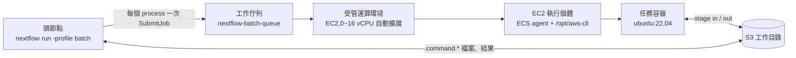
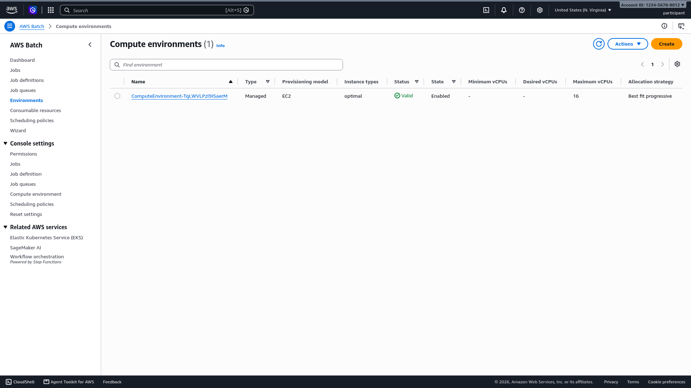
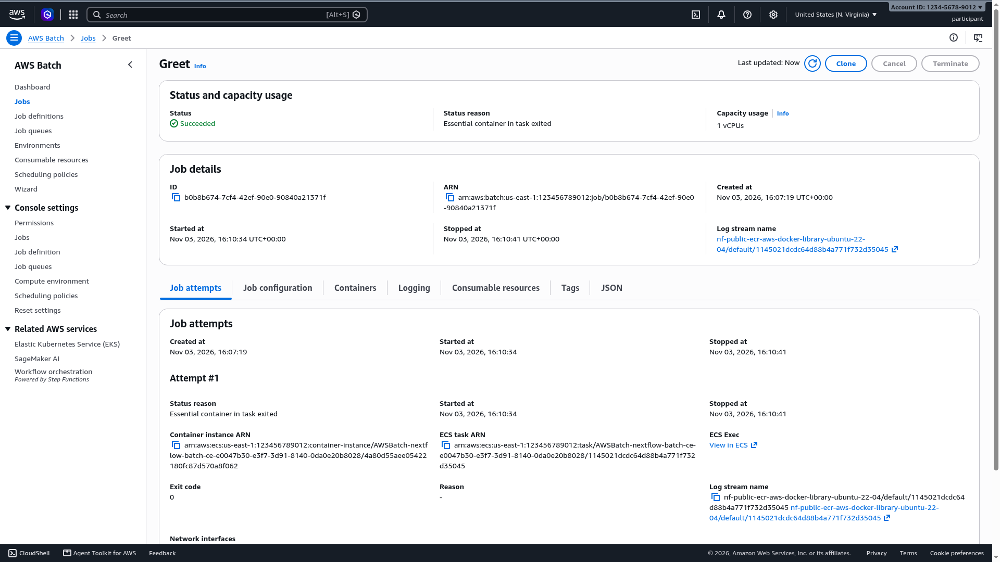

# 在 AWS Batch 上執行 Nextflow:15 分鐘動手實作

從一個空的帳戶開始,在 AWS Batch 上完整執行一次 Nextflow 管線。這個實作是 [AWS HealthOmics: Modernizing Genomics from Storage to GenAI](https://catalog.us-east-1.prod.workshops.aws/workshops/6bff9693-78fe-4ab5-9695-0d85356f4d80/en-US) 工作坊的姊妹實作,直接沿用該工作坊的 GreetingsNF 管線,讓你能並排比較兩種執行引擎。它也可以單獨使用,任何有預設 VPC 的 AWS 帳戶都能跑。

[English guide](../README.md) · [한국어 가이드](README.ko.md)

## 為什麼 Nextflow 和 AWS Batch 很合

Nextflow 把管線邏輯和執行位置分開。管線是一組用 channel 串起來的 process,每個 process 宣告自己的輸入、輸出、資源需求(`cpus`、`memory`)和容器映像。process 實際在哪裡執行,由 `nextflow.config` 裡選的 *執行器(executor)* 決定,所以同一份 `main.nf` 可以不改一行就在筆電、HPC 排程器或雲端服務上執行。執行器負責把輸入搬到目標環境、用該平台的 API 提交任務、監看狀態、再把輸出收回來。

[AWS Batch](https://docs.aws.amazon.com/batch/latest/userguide/what-is-batch.html) 是一個全受管服務,負責佈建運算資源並大規模排程容器化的批次工作。你把一個[工作佇列](https://docs.aws.amazon.com/batch/latest/userguide/job_queues.html)關聯到一或多個[受管運算環境](https://docs.aws.amazon.com/batch/latest/userguide/managed_compute_environments.html),並在運算環境中設定允許的執行個體類型、最大 vCPU 數,以及 EC2 隨需或 Spot 容量。在本實作的 Amazon ECS 環境中,工作以[容器化應用程式的形式在 ECS 容器執行個體上執行](https://docs.aws.amazon.com/batch/latest/userguide/jobs.html)。AWS Batch 依照設定的[執行個體類型分配策略](https://docs.aws.amazon.com/batch/latest/userguide/allocation-strategies.html)替佇列中的工作選擇運算容量,當資源需求放得下時,可以把多個工作放在同一台執行個體上。因為本實作把 [`minvCpus` 設為 `0`](https://docs.aws.amazon.com/batch/latest/userguide/scaling-updates.html),排隊的工作做完後運算環境可以縮減回 0。你不需要安裝或維運另外的批次排程軟體。

這兩個工具幾乎是一對一對應。Nextflow 的 process 變成 Batch 的 job,process 的 container 指示詞變成 job 的映像,[`cpus` 指示詞](https://docs.seqera.io/nextflow/reference/process/directives/cpus)定義每個任務需要的 CPU 數,和 `memory` 一起成為 job 的資源請求,也就是 AWS Batch 選擇合適運算容量的依據。手動操作 Batch 時最繁瑣的部分,Nextflow 都代勞了:替每個容器映像註冊工作定義(job definition),以[每個工作的資源覆寫(override)](https://docs.aws.amazon.com/batch/latest/APIReference/API_ContainerOverrides.html)帶入每個任務的 CPU 與記憶體,透過 S3 工作目錄暫存(stage)輸入輸出,重試失敗的任務,並沿用環境中的 IAM 憑證。Seqera 的工程文章 [Nextflow and AWS Batch: Inside the Integration](https://seqera.io/blog/nextflow-and-aws-batch-inside-the-integration-part-1-of-3/) 詳細說明了這套對應關係,而該文指出的唯一代價,也是你在這個實作中會親眼看到的:運算環境從 0 開始啟動執行個體時的啟動延遲。

## 內容組成

| 檔案 | 用途 |
|---|---|
| `main.nf` | GreetingsNF。只有一個 process 的 Nextflow 管線,和 HealthOmics 工作坊中註冊為 private workflow 的檔案相同。放在儲存庫根目錄,讓 `nextflow run hmkim/nextflow-aws-batch-lab` 可以直接執行。 |
| `cfn/batch-nextflow.yaml` | CloudFormation 範本。IAM 執行個體角色、EC2 啟動範本、受管運算環境(0~16 vCPU)、工作佇列。含可選的 Mountpoint for Amazon S3 模式。 |
| `scripts/setup-nextflow-batch.sh` | 一次完成、可重複執行(冪等)的設定指令碼。安裝 Java 17 和 Nextflow 24.10、部署範本、寫出 `nextflow.config`。 |
| `scripts/run-cost.py` | 依 trace 檔案估算一次執行的成本,按 process 和執行個體拆分。 |
| `pipeline/ref-check.nf` | 選用。不暫存參考檔案,而是透過 Mountpoint for Amazon S3 掛載直接讀取。 |
| `docs/KIRO.zh-TW.md` | 同一個實作改由 Kiro CLI 或 Kiro IDE 的聊天視窗進行。每一步列出要輸入的一個提示詞、Kiro 執行的指令、會出現的核准提示和預期結果。Kiro 遵循的規則在 `.kiro/steering/aws-batch-lab.md`。 |
| `docs/` | 韓文與繁體中文指南、主控台截圖。 |

## 運作架構

Nextflow 本身(頭節點,head node)在你執行它的任何地方運作:工作坊 IDE、筆電、EC2 執行個體都可以。它為每個 process 提交一個 AWS Batch 工作(job),Batch 把工作放到運算環境的 EC2 執行個體上,拉取容器映像並執行任務指令碼。輸入從 Amazon S3 暫存到容器內,輸出再寫回 S3 工作目錄。這個過程使用啟動範本安裝在執行個體上的 AWS CLI,Nextflow 會把它掛載進容器裡。



頭節點放在哪裡,比想像中重要。筆電也能跑,但 Nextflow 程序必須在整個執行期間保持存活且網路不中斷。像這個實作一樣在 EC2 執行個體或雲端 IDE 上執行,跑幾小時的管線時就可以把筆電合上。要把長時間執行從終端機脫離時,不要用 `nohup ... &`,改用 Nextflow 自己的背景旗標(Nextflow 會讀取終端機,所以單純用 `&` 的工作會被停住):

```bash
nextflow -bg run main.nf -profile batch --addressee 'detached' -ansi-log false > run.log 2>&1
```

無人值守的正式執行,請改用 `tmux` 或 Seqera Platform 這類啟動器。

## 事前準備

- 一個 AWS 帳戶,以及可以使用 `sudo` 的 Linux shell(指令碼用 `dnf` 安裝 Java。其他發行版請自行安裝 Java 17,指令碼會跳過該步驟)。
- 目標區域中有公有子網路的預設 VPC。有 NAT 閘道的私有子網路也可以,透過 `SUBNET_IDS` 傳入。
- 作為 Nextflow 工作目錄的 S3 儲存貯體。在 HealthOmics 工作坊帳戶中,指令碼會自動找到 `omics-output-*` 儲存貯體;其他情況請指定 `WORK_BUCKET`。
- 從環境取得的憑證:執行個體角色或 AWS CLI 設定檔。不要在 `nextflow.config` 裡寫 `aws.accessKey` / `aws.secretKey`。產生的檔案裡也有同樣的註解提醒。

權限分成兩個階段。**設定**(部署 CloudFormation 堆疊)會建立 IAM 角色、啟動範本和 Batch 資源,需要 `PowerUserAccess` + `IAMFullAccess` 這類管理員等級的權限。之後的**管線執行**需要的權限少得多。下面這份政策取自 [Seqera `awsbatch` 執行器參考文件](https://docs.seqera.io/nextflow/reference/executor/aws-batch/),頭節點有這些就夠了。

<details>
<summary>Nextflow 頭節點的最小 IAM 政策</summary>

```json
{
  "Version": "2012-10-17",
  "Statement": [
    {
      "Sid": "BatchJobs",
      "Effect": "Allow",
      "Action": [
        "batch:CancelJob",
        "batch:DescribeComputeEnvironments",
        "batch:DescribeJobDefinitions",
        "batch:DescribeJobQueues",
        "batch:DescribeJobs",
        "batch:ListJobs",
        "batch:RegisterJobDefinition",
        "batch:SubmitJob",
        "batch:TagResource",
        "batch:TerminateJob"
      ],
      "Resource": "*"
    },
    {
      "Sid": "InspectInstances",
      "Effect": "Allow",
      "Action": [
        "ec2:DescribeInstanceAttribute",
        "ec2:DescribeInstances",
        "ec2:DescribeInstanceStatus",
        "ec2:DescribeInstanceTypes",
        "ecs:DescribeContainerInstances",
        "ecs:DescribeTasks"
      ],
      "Resource": "*"
    },
    {
      "Sid": "WorkDirectory",
      "Effect": "Allow",
      "Action": [
        "s3:ListBucket",
        "s3:GetBucketLocation",
        "s3:GetObject",
        "s3:PutObject",
        "s3:DeleteObject",
        "s3:AbortMultipartUpload",
        "s3:ListMultipartUploadParts"
      ],
      "Resource": [
        "arn:aws:s3:::WORK_BUCKET",
        "arn:aws:s3:::WORK_BUCKET/*"
      ]
    }
  ]
}
```

請把 `WORK_BUCKET` 換掉。如果容器映像放在私有 ECR 儲存庫,再加上 `AmazonEC2ContainerRegistryReadOnly`。運算執行個體使用堆疊建立的另一個角色。

</details>

在工作坊 IDE(Amazon Linux 2023,`m8i.large`)上量到的時間:設定 3 分 13 秒,首次執行 3 分 41 秒,第二次執行 35 秒。

## 步驟 1:設定環境

複製儲存庫並執行設定指令碼。每一步都是冪等的,中途停下來只要重跑即可。

```bash
git clone https://github.com/hmkim/nextflow-aws-batch-lab.git
cd nextflow-aws-batch-lab
bash scripts/setup-nextflow-batch.sh
```

如果不是工作坊帳戶,先指定工作儲存貯體:

```bash
WORK_BUCKET=my-nextflow-work-bucket bash scripts/setup-nextflow-batch.sh
```

指令碼會為每個步驟印出一個區段。CloudFormation 步驟最久,大約 3 分鐘:

```
==> 1/5 Installing Java 17 and Nextflow
    Installed openjdk version "17.0.21" 2026-10-20 LTS
    Installed version 24.10.5 build 5935
==> 2/5 Discovering region, VPC and buckets
    Region      : us-east-1
    Account     : <ACCOUNT_ID>
    VPC         : <VPC_ID>
    Subnets     : <SUBNET_ID_1>,<SUBNET_ID_2>,...
    Work bucket : s3://omics-output-us-east-1-<ACCOUNT_ID>
==> 3/5 Deploying AWS Batch stack 'nextflow-batch' (3-5 minutes)
Successfully created/updated stack - nextflow-batch
    Job queue   : nextflow-batch-queue
==> 4/5 Writing nextflow.config
    profile 'batch' -> queue nextflow-batch-queue, workDir s3://.../nextflow-batch/work
==> 5/5 Preparing the GreetingsNF pipeline

Setup complete. Next:

    nextflow run main.nf -profile batch --addressee 'AWS Batch'
```

<details>
<summary><b>想自己動手做?</b> 這是指令碼執行的五個步驟。</summary>

**1. 安裝 Java 和 Nextflow。** Nextflow 24.10 是 AWS HealthOmics 執行的版本系列。版本很重要:Nextflow 25 以上預設啟用更嚴格的解析器,會拒絕 `main.nf` 最上層的 `if (...) exit 1` 語法。(`curl -s https://get.nextflow.io | bash` 會安裝最新版,所以會碰到這個錯誤。)

```bash
sudo dnf install -y java-17-amazon-corretto-headless
mkdir -p ~/.local/bin
curl -fsSL https://github.com/nextflow-io/nextflow/releases/download/v24.10.5/nextflow-24.10.5-dist \
  -o ~/.local/bin/nextflow
chmod +x ~/.local/bin/nextflow
nextflow -version
```

**2. 查詢帳戶設定值。**

```bash
export AWS_REGION=us-east-1
export VPC_ID=$(aws ec2 describe-vpcs --filters Name=is-default,Values=true \
  --query 'Vpcs[0].VpcId' --output text)
export SUBNET_IDS=$(aws ec2 describe-subnets \
  --filters Name=vpc-id,Values="$VPC_ID" Name=default-for-az,Values=true \
  --query 'Subnets[].SubnetId' --output text | tr '\t' ',')
export WORK_BUCKET=my-nextflow-work-bucket
```

**3. 部署 CloudFormation 堆疊。** 子網路清單裡有逗號,所以參數用 JSON 檔案傳入。

```bash
cat > .stack-parameters.json <<EOF
[
  {"ParameterKey": "VpcId",      "ParameterValue": "$VPC_ID"},
  {"ParameterKey": "SubnetIds",  "ParameterValue": "$SUBNET_IDS"},
  {"ParameterKey": "WorkBucket", "ParameterValue": "$WORK_BUCKET"}
]
EOF

aws cloudformation deploy \
  --stack-name nextflow-batch \
  --template-file cfn/batch-nextflow.yaml \
  --parameter-overrides file://.stack-parameters.json \
  --capabilities CAPABILITY_IAM
```

**4. 寫出 `nextflow.config`。** `batch` profile 把 process 提交到佇列、把中間檔案放在 S3,並使用啟動範本安裝在每台執行個體上的 AWS CLI。這個檔案裡沒有憑證,Nextflow 會從執行個體角色或 AWS CLI 設定檔取得。

```groovy
profiles {
    batch {
        process {
            executor  = 'awsbatch'
            queue     = 'nextflow-batch-queue'
            container = 'public.ecr.aws/docker/library/ubuntu:22.04'
        }
        workDir = 's3://my-nextflow-work-bucket/nextflow-batch/work'
        aws {
            region = 'us-east-1'
            batch {
                cliPath = '/opt/aws-cli/bin/aws'
                maxParallelTransfers = 4
            }
        }
    }
}
```

執行器參考文件的兩條規則在這裡已經遵守:每個 process 都有 `container`(在 profile 層級指定一次),而且 `workDir` 是儲存貯體下的子路徑,不是根目錄。

**5. 準備管線。** `main.nf` 把結果發佈到 HealthOmics 的輸出路徑 `/mnt/workflow/pubdir`,所以同一個檔案在兩種引擎上都能跑。

```bash
sudo mkdir -p /mnt/workflow/pubdir
sudo chown "$(id -u):$(id -g)" /mnt/workflow/pubdir
```

</details>

### 堆疊建立的資源

| 資源 | 用途 |
|---|---|
| IAM 角色與執行個體設定檔 | 運算執行個體以這個角色執行。附有 ECS agent 政策和工作儲存貯體的讀寫權限,任務不需要另外的憑證就能暫存檔案。 |
| 啟動範本 | user data 在 `/opt/aws-cli` 下安裝一個獨立的 AWS CLI。這不是 AWS CLI v2 安裝程式,而是一個 conda 環境(conda-forge 的 `awscli` 套件,用 micromamba 建立)。v2 版本依賴 `libz` 這類主機函式庫,在 biocontainers 那種極簡映像裡跑不起來;conda 版本則把需要的函式庫全部放在 `/opt/aws-cli` 裡。Nextflow 會把 `cliPath` 的 *上上層* 目錄以相同路徑掛載進每個任務容器,所以 `/opt/aws-cli/bin/aws` 只會掛載 `/opt/aws-cli`。請保留這個路徑;若用 `/usr/local/bin/aws` 之類的路徑,容器裡整個 `/usr/local` 都會被遮住。 |
| 運算環境 | 受管、EC2、`optimal` 執行個體類型、0~16 vCPU。有工作進來時 Batch 啟動執行個體,閒置幾分鐘後終止。 |
| 工作佇列 | `nextflow-batch-queue`。Nextflow profile 提交工作的目標名稱。 |

確認佇列已連接到一個有效且閒置的運算環境:

```bash
aws batch describe-job-queues --job-queues nextflow-batch-queue \
  --query 'jobQueues[0].[jobQueueName,state,status]' --output text
aws batch describe-compute-environments \
  --query 'computeEnvironments[].[computeEnvironmentName,state,status,computeResources.desiredvCpus]' \
  --output table
```

```
nextflow-batch-queue    ENABLED VALID
|  nextflow-batch-ce-lt1 |  ENABLED |  VALID |  0   |
```



## 步驟 2:執行管線

和本機執行或 HealthOmics 執行相比,唯一的差別是選了哪個 profile。

```bash
nextflow run main.nf -profile batch --addressee 'AWS Batch' -with-trace
```

```
 N E X T F L O W   ~  version 24.10.5
Launching `main.nf` [reverent_williams] DSL2 - revision: d6e8fbf8eb
executor >  awsbatch (1)
[eb/a44df8] Greet | 0 of 1
```

任務本身幾毫秒就結束了。執行時間幾乎全部花在 Batch 為空的運算環境啟動第一台 EC2 執行個體。等待期間,打開 [AWS Batch 主控台的 Jobs 頁面](https://console.aws.amazon.com/batch/home#jobs),選擇 `nextflow-batch-queue`,再點 **Search**。


一個 Nextflow process 對應一個以 process 名稱命名的 Batch 工作。工作依序經過 `RUNNABLE`(等待容量)、`STARTING`(執行個體註冊、拉取映像)、`RUNNING`。截圖中第一個 `Greet` 工作在 16:07:19 建立、16:10:34 開始:等了 3 分鐘的執行個體,然後執行 7 秒。在執行個體仍存活時提交的第二個工作,建立 5 秒後就開始了。

點工作名稱打開詳細頁面。



日誌串流名稱以 `nf-public-ecr-aws-docker-library-ubuntu-22-04` 開頭,這是 Nextflow 用 profile 中的容器映像註冊的工作定義。ECS 任務和容器執行個體的 ARN 顯示 Batch 是以 ECS 任務的形式,在運算環境的執行個體上執行這個工作。打開 **Job configuration** 分頁看 command,會發現不是你的指令碼,而是一行 `bash -o pipefail -c "... .command.run"`。Nextflow 用同一個包裝器送出所有任務,包裝器從 S3 下載 `.command.sh` 執行,再把輸出上傳。**Logging** 分頁是任務的標準輸出,和 Nextflow 複製成 `.command.log` 的內容相同。

### 確認結果

```
[eb/a44df8] Greet | 1 of 1 ✔
Completed at: 03-Nov-2026 16:10:58
Duration    : 3m 41s
Succeeded   : 1
```

```bash
cat /mnt/workflow/pubdir/output
# hello AWS Batch

aws s3 ls --recursive s3://$WORK_BUCKET/nextflow-batch/work/
```

```
16:07:19      12769 .../eb/a44df8.../.command.run
16:07:19         52 .../eb/a44df8.../.command.sh
16:10:36          6 .../eb/a44df8.../.command.begin
16:10:39         16 .../eb/a44df8.../.command.out
16:10:41          1 .../eb/a44df8.../.exitcode
16:10:41         16 .../eb/a44df8.../output
```

`.command.sh` 是 process 的指令碼,`.command.run` 是 Nextflow 產生、用 AWS CLI 暫存檔案的包裝器,`.command.begin` 是容器啟動的時間點。提交時上傳的 `.command.run` 和 `.command.begin` 之間的 3 分鐘空檔,就是執行個體的啟動時間。trace 檔案以任務為單位呈現同樣的資訊:

```bash
cut -f4,6,7,8,9 trace-*.txt | column -t
# name   exit  submit                   duration  realtime
# Greet  0     2026-11-03 16:07:19.268  3m 29s    4ms
```

接著看 Nextflow 代你在 Batch 註冊了什麼:

```bash
aws batch describe-job-definitions --status ACTIVE \
  --query 'jobDefinitions[].[jobDefinitionName,revision,containerProperties.image,containerProperties.resourceRequirements]' \
  --output table
```

只有一個以 profile 映像名稱命名的工作定義 `nf-public-ecr-aws-docker-library-ubuntu-22-04`,上面寫著預留值 1 vCPU / 1 GiB。Nextflow 為每個容器映像(以及掛載磁碟區這類容器層級的設定;稍後開啟 Mountpoint 模式時會多出一個 revision)建立一個工作定義,並在多次執行間重複使用。任務實際的 CPU 和記憶體不在工作定義裡,而是由 Nextflow 在提交時以每個工作的覆寫帶入,下一個實驗會看到。如果一個管線有 10 個 process 用 3 個映像,工作定義就是 3 個,在第一次使用時建立。你永遠不需要親手寫它們。

同樣的標準輸出也會留在 CloudWatch Logs 的 `/aws/batch/job` 日誌群組,每個工作一個串流;**Logging** 分頁顯示的就是這個串流。日誌儲存會計費,所以開始跑真正的工作量之後,替這個群組設定保留期間:

```bash
aws logs put-retention-policy --log-group-name /aws/batch/job --retention-in-days 30
```

### 再執行一次

```bash
nextflow run main.nf -profile batch --addressee 'warm run'
```

```
[6c/6541a3] Greet | 1 of 1 ✔
Duration    : 35s
```

3 分 41 秒和 35 秒的差距,就是從 0 開始擴展的代價。在正式環境中,可以替運算環境設定最小 vCPU,用閒置成本換掉這段延遲;如果管線很少執行,就接受這段延遲。

第二個指令請在第一次執行結束後 1~2 分鐘內執行。佇列一空,Batch 大約 2 分鐘後就會終止閒置的執行個體,之後提交的執行又會變成冷啟動。量測值:在前一個工作結束 2 分 20 秒後提交的執行,等了 3 分 11 秒才拿到新的執行個體。

### 實驗:不動管線,改變資源請求

`cpus` 和 `memory` 是 Batch 挑選執行個體的依據。這個管線兩者都沒有指定,所以任務請求了預設的 1 vCPU / 1 GiB,Batch 選了 `c6i.large`。用第二個設定檔只覆寫一個 process 的值,然後重新執行。`-c` 會把檔案疊在 `nextflow.config` 之上,所以 profile 保持不變:

```bash
cat > resources.config <<'EOF'
process {
    withName: 'Greet' {
        cpus   = 4
        memory = '8 GB'
    }
}
EOF

nextflow run main.nf -profile batch -c resources.config --addressee 'bigger'
```

在主控台打開新的工作,**Capacity usage** 會顯示 4 vCPU,`describe-jobs` 則顯示 Nextflow 在和之前相同的工作定義 revision 之上,以容器覆寫送出的請求:

```bash
JOB=$(aws batch list-jobs --job-queue nextflow-batch-queue --job-status SUCCEEDED \
  --query "sort_by(jobSummaryList,&createdAt)[-1].jobId" --output text)
aws batch describe-jobs --jobs $JOB \
  --query 'jobs[0].[jobDefinition,container.resourceRequirements]' --output text
# ...job-definition/nf-public-ecr-aws-docker-library-ubuntu-22-04:1
# 8192    MEMORY
# 4       VCPU
```

Batch 用 `m6i.xlarge`(4 vCPU、16 GiB)回應了這個請求,而不是 1 vCPU 任務時選的 `c6i.large`。`optimal` 的意思是「能容納等待中工作的最便宜執行個體」。工作定義清單沒有變長,`main.nf` 也沒有改。當真正的任務需要 32 GiB 時,要轉的就是這個旋鈕:管線保持可攜性,設定檔負責尺寸。

### 直接從 GitHub 執行

Nextflow 可以從 Git 儲存庫取得管線,而不只是本機目錄。這個儲存庫的 `main.nf` 在根目錄,所以只要機器上有 Nextflow 和設定指令碼產生的 `nextflow.config`,下面這行在哪裡都能跑:

```bash
nextflow -C nextflow.config run hmkim/nextflow-aws-batch-lab -profile batch --addressee 'from GitHub'
```

Nextflow 會把儲存庫複製到 `~/.nextflow/assets/` 執行,並在 `revision:` 那行顯示使用的 commit。用 `-r <標籤或 commit>` 可以固定版本。團隊發佈管線就是這麼做的(nf-core 也一樣);設定檔因為含有佇列和儲存貯體名稱,留在本機。

### 請 Kiro 解釋這次執行

如果已經安裝並登入 Kiro CLI,把日誌交給它:

```bash
kiro-cli chat --no-interactive --trust-tools=fs_read,execute_bash \
  "Read nextflow.config, .nextflow.log and trace-*.txt in the current directory. In under 150 words, \
tell me which AWS Batch job queue and container image the Greet task used, how long the task waited \
between submission and start, and why. Then run \
'aws batch describe-compute-environments --query computeEnvironments[].computeResources.desiredvCpus' \
and report the value."
```

測試時 Kiro 報告了 profile 中的佇列和映像、`createdAt` 與 `startedAt` 之間 195 秒的等待、原因是運算環境從 0 開始擴展,以及執行個體已經歸還所以 `desiredvCpus` 為 `[0]`。

## HealthOmics 與 AWS Batch 並排比較

| | AWS HealthOmics | AWS Batch(本實作) |
|---|---|---|
| 要準備什麼 | workflow 定義和一個 IAM 角色 | IAM 角色、啟動範本、運算環境、工作佇列、Nextflow 頭節點 |
| 如何啟動執行 | `aws omics start-run`,服務負責執行頭節點 | 在你自己管理的機器上執行 `nextflow run -profile batch` |
| 運算 | 服務依任務選擇 | 你自己定義的運算環境:執行個體家族、最小/最大 vCPU、Spot 或隨需、自訂 AMI |
| 容器映像 | 帳戶內的 Amazon ECR | 執行個體能存取的任何登錄(ECR、ECR Public、Docker Hub) |
| 資料暫存 | 服務管理的共用檔案系統 | Nextflow 用執行個體上的 AWS CLI,每個任務從 S3 暫存 |
| 量到的首個任務延遲 | 約 1~2 分鐘 | 冷啟動 3 分 29 秒,暖啟動 5 秒 |
| 日誌 | CloudWatch,依執行分組 | `/aws/batch/job` 中每個工作一個 CloudWatch 串流,加上 S3 中的 `.command.*` 檔案 |
| 每個任務的成本 | 每次執行都顯示:每個任務的執行個體類型和價格 | 需要推導:當下用 `run-cost.py` 估算,一天後用 CUR 的 Split Cost Allocation Data |
| 要維運什麼 | 執行之間沒有 | 容量、AMI 更新、頭節點、工作目錄的生命週期 |

沒有哪一邊絕對更好。HealthOmics 消除了維運負擔,按執行計費;Batch 開放所有設定,適合需要服務沒提供的硬體或軟體,或平台的其他部分已經在 Batch 上執行的情況。同一份 `main.nf` 兩邊都能當目標。

## 量測成本

AWS Batch 本身不收費。一次執行的成本是運算環境的 EC2 執行個體(加上它的 EBS 磁碟區、S3 工作目錄和 CloudWatch Logs,相比之下都很小),而且一台執行個體由多個工作共用。所以「每個工作的成本」在帳單上並不存在,必須把每台執行個體的成本分攤到在它上面執行的工作。有兩種做法:用執行記錄當下算出的估計值,以及 AWS 一天後給出的精確數字。

### 當下:`scripts/run-cost.py`

這個指令碼讀取執行的 trace 檔案,向 Batch 查詢每個工作的資源請求、開始與結束時間和執行所在的執行個體,再查詢這些執行個體的隨需價格,最後印出兩個總計。

- **attributed(歸屬)**:任務用掉的份額。執行個體價格 × 工作執行時間 × 工作保留的執行個體 vCPU 或記憶體比例(取較大者)。這是在本機套用 AWS Split Cost Allocation Data(見下文)同一套分攤規則的結果。
- **incurred(實際發生)**:EC2 實際計費的金額。執行所用的每台執行個體,從啟動到終止按每小時價格計算。

```bash
uv run --with boto3 scripts/run-cost.py trace-sarek.txt
```

sarek 測試執行的輸出(部分省略):

```
Run: trace-sarek.txt   tasks: 23   region: us-east-1

process                                                    tasks   runtime      wait  attributed
NFCORE_SAREK:SAREK:FASTQ_ALIGN_BWAMEM_MEM2_DRAGMAP_SENTIEO     2       25s       41s $   0.0023
NFCORE_SAREK:SAREK:MULTIQC                                     1       27s       36s $   0.0020
NFCORE_SAREK:SAREK:BAM_MARKDUPLICATES:GATK4_MARKDUPLICATES     1       19s       28s $   0.0018
NFCORE_SAREK:SAREK:FASTQC                                      2       21s     6m23s $   0.0010
...
TOTAL attributed (what the tasks used)                        23     3m45s    20m13s $   0.0109

instance             type             $/h  jobs      span   incurred  attributed
<INSTANCE_ID_1>     c6i.2xlarge   0.3400     6     4m07s $  0.0233 $   0.0023
<INSTANCE_ID_2>     c6i.2xlarge   0.3400    17    6m14s+ $  0.0353 $   0.0086
TOTAL incurred (what EC2 billed)                         $  0.0586 $   0.0109

Utilisation (attributed / incurred): 19%  -- the rest is instance start-up, image pulls and idle time.
```

整次執行 6 美分,其中只有五分之一花在任務上。兩個 FASTQC 工作等了第一台執行個體 6 分鐘,然後各執行 10 秒。這就是在縮減到 0 的環境裡跑小型測試管線的樣子;有數小時比對工作的正式執行,會把執行個體填得緊密許多。運算環境的 `MinvCpus`、Spot 計價、更大的執行個體類型都會改變這些數字,而這個指令碼可以量測每一項的效果。

請在管線結束後 1 小時內執行這個指令碼。之後已終止的執行個體會從 EC2 和 ECS API 消失,指令碼只能改用 Fargate 的 vCPU 與 GB 單價計算歸屬成本並在該列標上 `*`,實際發生成本則完全算不出來。需要的權限是 `batch:DescribeJobs`、`ecs:DescribeContainerInstances`、`ec2:DescribeInstances`、`pricing:GetProducts`、`ssm:GetParameter`。

### 精確數字:成本分配標籤與 Split Cost Allocation Data

真正的工作負載請直接用帳單資料。產生的 `nextflow.config` 已經替每個 Batch 工作加上執行名稱、session ID、管線和 process 名稱的標籤。

```groovy
process.resourceLabels = { [
    'nf-run'      : workflow.runName,
    'nf-session'  : workflow.sessionId.toString(),
    'nf-pipeline' : (workflow.manifest.name ?: workflow.scriptName),
    'nf-process'  : task.process
] }
```

Nextflow 把它們當作 `SubmitJob` 的標籤傳入,並以 `propagateTags` 註冊工作定義,所以標籤會一路傳到 ECS 任務。可以用 `aws batch describe-jobs --jobs <id> --query 'jobs[0].tags'` 確認。(閉包(closure)的寫法很重要:一般的 map 會在設定解析時求值,那時 `workflow` 還不存在。)Batch 會再加上 `aws:batch:job-queue`、`aws:batch:compute-environment`、`aws:batch:job-definition` 標籤。

[Split Cost Allocation Data](https://docs.aws.amazon.com/cur/latest/userguide/split-cost-allocation-data.html) 把這些標籤變成金額。它在 Cost and Usage Report 中為每個 ECS 任務新增一列,依任務保留的 CPU 和記憶體比例把執行個體成本拆進去,並把任務的標籤套用到該列。AWS Batch 工作就是 ECS 任務,所以直接適用([發佈文章](https://aws.amazon.com/blogs/aws-cloud-financial-management/la-improve-cost-visibility-of-containerized-applications-with-aws-split-cost-allocation-data-for-ecs-and-batch-jobs/))。在付款帳戶的 Billing and Cost Management 主控台設定一次即可,全部免費。

1. **Cost allocation tags**:啟用 `nf-run`、`nf-pipeline`、`nf-process`(第一個帶標籤的工作執行後才會出現在清單中)。
2. **Cost Management preferences**:在 *Split cost allocation data* 中選擇加入 Amazon ECS。
3. **Data Exports**:建立匯出到 S3 的 CUR 2.0,勾選 *Include split cost allocation data*。用 Athena 查詢。

資料在使用後約 24 小時才會出現,而且只在匯出中,Cost Explorer 看不到。把一次執行按 process 拆開的查詢:

```sql
SELECT resource_tags['user_nf_process']        AS process,
       COUNT(*)                                 AS task_hours,
       SUM(split_line_item_split_cost)          AS used_usd,
       SUM(split_line_item_unused_cost)         AS idle_share_usd
FROM   cur2
WHERE  resource_tags['user_nf_run'] = 'reverent_williams'
GROUP  BY 1 ORDER BY 3 DESC;
```

`split_line_item_split_cost` 是任務消耗的份額,`split_line_item_unused_cost` 是執行個體閒置容量中分配給該任務的份額。以執行為單位加總,會和所用執行個體的 EC2 項目一致,而這正是 `run-cost.py` 在近似的對照。要看一個月內每次執行的成本,改用 `user_nf_run` 取代 `user_nf_process` 分組即可。

這條路在沒有帳單主控台存取權的工作坊沙箱帳戶中無法使用,請在自己的帳戶設定。

### 用實際帳單核對估計值

兩條路都用同一個管線 nf-core/sarek `test`(23 個任務,執行名稱 `cranky_ride`)在已啟用 split cost allocation data 的帳戶上執行。`run-cost.py` 在管線結束幾分鐘後執行,含 split 資料的 CUR 2.0 匯出約 28 小時後到達。

| | `run-cost.py`(當下) | Cost and Usage Report(次日) |
|---|---|---|
| 任務用掉的份額(attributed / `split_line_item_split_cost`) | $0.0112 | $0.0090 |
| 閒置份額(`split_line_item_unused_cost`) | 未分開 | $0.0619 |
| 執行個體計費金額(incurred / EC2 `BoxUsage` 項目) | $0.0653 | $0.0709 |
| 使用 + 閒置 vs EC2 項目 | | $0.0709 vs $0.0709 |
| 使用率 | 17% | 13% |

三件事值得注意。CUR 的 split + unused 合計與 5 台執行個體的 EC2 項目精確到小數點後第五位,這是帳單資料能保證、估計值做不到的。指令碼的 incurred 低了 8%,因為呼叫指令碼時最後一台執行個體還在跑,而 Batch 會在最後一個工作之後讓每台執行個體多活幾分鐘;指令碼輸出中的 `+` 標記指的就是這種情況。attributed 高了 25%,因為指令碼用執行個體的每小時混合單價計算 CPU 和記憶體,而 split cost allocation data 用 Fargate 價格推導出的 9:1 權重分別計算 vCPU-小時和 GB-小時,所以 1 vCPU / 1 GiB 的任務在 CUR 中比較便宜。兩邊的 process 排名相同,對這次執行的結論也相同:錢大部分花在等待,不是運算。

實際操作得到的兩個備註。`nf-*` 標籤鍵要等第一筆帶標籤的用量處理完(執行後約一天)才會出現在 Billing 主控台,所以執行當天的 `update-cost-allocation-tags-status` 以 `Tag keys not found` 失敗,次日才成功。啟用標籤後執行 `start-cost-allocation-tag-backfill`,可以套用到該月份更早的用量。即使回填還沒完成,Batch 加上的 `aws:batch:job-queue`、`aws:batch:job-definition`、`aws:batch:compute-environment` 標籤已經在任務列上,足以篩出某個佇列的工作,上表就是這樣做出來的。

### HealthOmics 怎麼做

HealthOmics 在服務自有的執行個體上按任務計費,所以每次執行本來就顯示任務層級的成本。主控台的執行頁面列出每個任務的執行個體類型和價格,`aws omics get-run-task` 回傳同樣的值。不用設定,也不用等。這份便利是受管服務收費的一部分;在 Batch 上你拿到的是原始的執行個體,歸屬計算要自己建。這就是這個實作一再回到的取捨。

## 正式環境備註

這個實作把所有設定都放在最簡單的狀態。進入真正的工作負載時,下面是最先要改的東西,全部都是設定或範本的變更,不是管線的變更。

**Spot 執行個體。** 用 `SPOT` 佈建模型建立第二個運算環境(範本中 `Type: SPOT`。`BEST_FIT_PROGRESSIVE` 策略不需要 `SpotIamFleetRole`,建議的分配策略是 `SPOT_PRICE_CAPACITY_OPTIMIZED`)並連接到佇列。Spot 容量可能在任務執行中被回收,所以讓 Batch 重試那些工作:

```groovy
aws.batch.maxSpotAttempts = 3
```

Batch 只重試 Spot 回收。其他失敗是 Nextflow 的事,常見的模式是只重試「被外部殺掉」的結束碼(130、137、143、151,分別是 SIGINT、OOM kill、SIGTERM、Spot 中斷),其餘就停下:

```groovy
process {
    errorStrategy = { task.exitStatus in [130, 137, 143, 151] ? 'retry' : 'finish' }
    maxRetries    = 3
}
```

**明確指定任務大小。** 替每個 process 給 `cpus` 和 `memory`(見上面的實驗)。Batch 用這些數字把容器塞進主機,沒有指定大小的任務會拿到 1 vCPU / 1 GiB,要嘛不夠用,要嘛浪費執行個體。

**替工作加標籤以便分攤成本。** 產生的設定已經把執行、session、管線、process 標籤加到工作上(見量測成本一節)。把專案或團隊這類鍵加進同一個 map,啟用成本分配標籤後就會出現在 Cost Explorer 和 CUR 中。

**延遲重要時保留最小容量。** 替運算環境設定 `MinvCpus: 2`,就會有一台小執行個體持續運作,3 分鐘的冷啟動消失,代價是那台執行個體的閒置時間。

**任務需要主機路徑時就掛載。** `aws.batch.volumes` 用 Docker 的 `host:container:mode` 語法,把主機目錄繫結掛載(bind mount)進每個任務容器。下面的 Mountpoint 一節會用到,完整選項在執行器參考文件的 [Volume mounts](https://docs.seqera.io/nextflow/reference/executor/aws-batch/#volume-mounts)。

**評估 Wave 和 Fusion。** Seqera 目前建議的 Batch 執行方式,是讓 Wave 建置內含 Fusion 檔案系統的容器。任務直接讀寫 S3,AMI 和映像裡都不需要 AWS CLI。這個實作刻意採用一般的 AWS CLI 路徑:不依賴外部服務,在受限網路也能運作,而且暫存過程直接顯示在 `.command.run` 裡。需求變大時,在 profile 裡加入 `wave.enabled = true`、`fusion.enabled = true` 並移除 `cliPath` 即可切換。

## 更進一步:用 Mountpoint for Amazon S3 串流參考資料

使用大型靜態參考檔案(VEP 快取、參考基因組和索引)的管線,會花很多時間替每個任務複製同樣的檔案。AWS HPC 部落格文章 [Optimize Nextflow workflows on AWS Batch with Mountpoint for Amazon S3](https://aws.amazon.com/blogs/hpc/optimize-nextflow-workflows-on-aws-batch-with-mountpoint-for-amazon-s3/) 說明 Genomics England 如何針對 500 GB 的 VEP 快取,把儲存貯體掛載到每台運算執行個體來避開這個問題。

範本支援這個模式。給它資料儲存貯體和掛載旗標,重新執行設定:

```bash
DATA_BUCKET=my-reference-bucket MOUNT_DATA_BUCKET=true bash scripts/setup-nextflow-batch.sh
```

啟動範本會加入 Mountpoint for Amazon S3,儲存貯體以唯讀方式掛載到每台執行個體的 `/mnt/s3-ref`(運算環境會被替換,約 2 分鐘),profile 裡也會加上 `aws.batch.volumes = '/mnt/s3-ref:/mnt/s3-ref:ro'`,讓任務容器內也看得到。

`pipeline/ref-check.nf` 示範了一條重要規則:掛載的目錄用 `val` 輸入接收,在 script 裡讀取檔案。

```groovy
process REF_SUMMARY {
    input:
        val ref_dir            // '/mnt/s3-ref/reference',不是 path 輸入
    script:
        """
        grep -vc '^#' ${ref_dir}/sample.gff3
        """
}
```

```bash
aws s3 cp sample.gff3 s3://my-reference-bucket/reference/sample.gff3
nextflow run pipeline/ref-check.nf -profile batch
```

如果把同一個目錄當 `path` 輸入傳入,頭節點會試著暫存只有運算執行個體看得到的檔案,出現 `Can't stage file /mnt/s3-ref/... -- file does not exist` 錯誤。這正是部落格文章指出的問題,本實作刻意重現它。

## 選用:執行真正的 nf-core 管線

GreetingsNF 展示了運作原理,但展示不了排程。[nf-core](https://nf-co.re/) 社群管線可以:數十個 process、多個容器映像、依樣本扇出(fan-out)、在報告階段扇入(fan-in)。每個 nf-core 管線都內建 `test` profile,指向小型公開資料集並限制資源(每個任務 4 CPU、15 GB、1 小時),所以在你已經建好的運算環境上可以直接跑。Batch 那一側什麼都不用改,只要在 profile 清單加上 `test` 並指定輸出位置。

推薦兩個管線。[nf-core/rnaseq](https://nf-co.re/rnaseq) 是 bulk RNA-seq 定量(修剪、STAR 或 Salmon 比對、計數、QC);[nf-core/sarek](https://nf-co.re/sarek) 是生殖細胞系與體細胞變異偵測,和 HealthOmics 工作坊的 GATK 模組同屬一類工作流程。在這個實作的 16 vCPU 運算環境上,sarek 測試約 15 分鐘(23 個任務),rnaseq 測試 18 分鐘(209 個任務、5 個樣本),大部分時間是執行個體啟動和容器拉取。啟動一個之後,就可以邊等邊讀完這一頁。

這個實作固定使用 Nextflow 24.10.5。目前的 nf-core 版本要求 Nextflow 25.10 以上,所以下面的指令固定使用能在 24.10 執行的最後版本:rnaseq `3.19.0` 和 sarek `3.5.1`。執行最新版本的方法在最後的備註。

### rnaseq

```bash
export WORK_BUCKET=$(aws s3api list-buckets \
  --query "Buckets[?starts_with(Name, 'omics-output-')].Name | [0]" --output text)

nextflow run nf-core/rnaseq -r 3.19.0 -profile test,batch \
  --outdir s3://$WORK_BUCKET/nextflow-batch/rnaseq-test \
  -with-trace trace-rnaseq.txt
```

Nextflow 把管線複製到 `~/.nextflow/assets/`,印出參數摘要後開始提交。Batch 主控台會被以 nf-core 模組命名的工作填滿(`NFCORE_RNASEQ:RNASEQ:FASTQ_QC_TRIM_FILTER_SETSTRANDEDNESS:...:FASTQC`、`...:ALIGN_STAR:STAR_ALIGN`、`...:MULTIQC`)。測試樣本表有 5 個樣本,所以多個工作會同時執行;在 **Environments** 可以看到運算環境長到 16 vCPU 上限(測試當時是 4 台 `xlarge` 執行個體),結束後回到 0。

輸出放在 `s3://$WORK_BUCKET/nextflow-batch/rnaseq-test/`,包含 `multiqc/star_salmon/multiqc_report.html`。下載後用瀏覽器打開:

```bash
aws s3 cp s3://$WORK_BUCKET/nextflow-batch/rnaseq-test/multiqc/star_salmon/multiqc_report.html .
```

### sarek

```bash
nextflow run nf-core/sarek -r 3.5.1 -profile test,batch \
  --outdir s3://$WORK_BUCKET/nextflow-batch/sarek-test \
  -with-trace trace-sarek.txt
```

測試 profile 用小型參考基因組執行單樣本生殖細胞系工作流程:BWA 索引與比對、標記重複、鹼基品質重校正、Strelka 變異偵測。VCF 放在 `sarek-test/variant_calling/strelka/test/` 下,報告在 `sarek-test/multiqc/multiqc_report.html`。把任務清單和 HealthOmics 工作坊的 GATK 執行比較一下:步驟是同一系列,只是引擎不同。

### 結束後看什麼

真正的管線讓 trace 檔案變得有趣。`duration` 是從提交到完成,`realtime` 是指令碼本身執行的時間,兩者的差就是佇列等待和容器拉取的時間:

```bash
awk -F'\t' 'NR>1 {print $8"\t"$9"\t"$4}' trace-rnaseq.txt | column -t -s$'\t' | less -S
```

大多數任務只執行幾秒,但從頭到尾花了 1 分鐘左右。新執行個體上的第一個任務承擔了執行個體啟動和映像拉取的成本,在執行個體空閒時提交的任務幾秒內就開始。數一下 process 出現的次數可以確認扇出:`SALMON_QUANT`、`STRINGTIE`、`FEATURECOUNTS` 各執行五次,每個樣本一次。

```bash
awk -F'\t' 'NR>1 {print $4}' trace-rnaseq.txt | sed 's/ (.*//' | sort | uniq -c | sort -rn | head
```

`aws batch describe-job-definitions --status ACTIVE` 現在列出兩個管線所用的每個容器映像各一個工作定義(兩次測試執行後共 38 個),都是第一次使用時建立的,和前面說明的一樣。如果執行中途失敗,在同一個指令加上 `-resume`:S3 工作目錄裡已經有輸出的任務,Nextflow 會跳過。

### 執行最新的 nf-core 版本

目前的 nf-core 版本要求比這個實作安裝的 24.10.5 更新的 Nextflow。Nextflow 的標準啟動器可以用 `NXF_VER` 變數即時下載並執行任何版本,所以不要動固定版本的二進位檔,而是在旁邊再裝一個:

```bash
curl -s https://get.nextflow.io -o ~/.local/bin/nextflow-launcher
chmod +x ~/.local/bin/nextflow-launcher

NXF_VER=25.10.4 nextflow-launcher run nf-core/rnaseq -r 3.27.0 -profile test,batch \
  --outdir s3://$WORK_BUCKET/nextflow-batch/rnaseq-test-latest
```

第一次呼叫會把該版本的 Nextflow 下載到 `~/.nextflow/`。`nextflow.config` 和 Batch 環境是共用的,其他都不變。測試當時,Nextflow 25.10.4 上的 rnaseq 3.27.0 在同一個運算環境以 21 分 40 秒完成 234 個任務。固定給 GreetingsNF 用的 `nextflow` 請保留原樣,它的 `main.nf` 用了新的嚴格解析器會拒絕的語法。

### 清理測試輸出

```bash
aws s3 rm --recursive s3://$WORK_BUCKET/nextflow-batch/rnaseq-test/
aws s3 rm --recursive s3://$WORK_BUCKET/nextflow-batch/sarek-test/
```

`nextflow-batch/work/` 下的工作目錄會在下面的清理步驟中一併刪除。

## 清理

```bash
aws cloudformation delete-stack --stack-name nextflow-batch
aws s3 rm --recursive s3://$WORK_BUCKET/nextflow-batch/
aws cloudformation wait stack-delete-complete --stack-name nextflow-batch
```

刪除運算環境會終止剩餘的執行個體,所以等待可能要幾分鐘。堆疊擁有 IAM 角色、啟動範本、運算環境和工作佇列,除此之外不會留下東西。Nextflow 註冊的工作定義不屬於堆疊;它們不收費,但要清乾淨的話用 `aws batch deregister-job-definition --job-definition <名稱>:<revision>` 移除。

## 疑難排解

| 症狀 | 原因與解法 |
|---|---|
| `main.nf:6` 出現 `Statements cannot be mixed with script declarations` | Nextflow 25+ 的嚴格解析器。改用 24.10.x(指令碼固定 24.10.5),或把 guard 移進 `workflow` 區塊。 |
| `JobQueue <queue> not found` | profile 的 `aws.region` 和部署堆疊的區域不同。 |
| 工作停在 `RUNNABLE` 超過 10 分鐘 | 運算環境啟動不了執行個體。檢查 EC2 vCPU 配額、子網路的自動指派公有 IP(或 NAT 路徑)、主控台中運算環境的狀態原因。也可參考 AWS 的 [RUNNABLE 卡住檢查清單](https://docs.aws.amazon.com/batch/latest/userguide/troubleshooting.html#job_stuck_in_runnable)。 |
| `Process <task> terminated for an unknown reason -- Likely it has been terminated by the external system` | Batch 無法執行啟動器。通常是容器映像有非 shell 的非標準 `ENTRYPOINT`,或執行個體上的 AWS CLI 跑不起來。檢查工作的 **Logging** 分頁和 CloudWatch 的 `/aws/batch/job`。 |
| `CloudFormation cannot update a stack when a custom-named resource requires replacing` | 從舊版範本變更了啟動範本。目前的範本把啟動範本版本放進運算環境名稱,因此可以替換。 |
| 任務以 `aws: command not found` 失敗 | `aws.batch.cliPath` 和啟動範本安裝 CLI 的路徑(`/opt/aws-cli/bin/aws`)不同。 |
| 任務結束碼 127,`/opt/aws-cli/bin/aws: error while loading shared libraries: libz.so.1` | 執行個體上的 CLI 是 AWS CLI v2 安裝程式版本,需要任務映像裡沒有的主機函式庫。請部署目前的範本,它安裝自帶函式庫的 conda 版 CLI。GreetingsNF 的 `ubuntu` 映像會掩蓋這個問題,biocontainers 映像會暴露它。 |
| `Can't stage file /mnt/s3-ref/...` | 掛載目錄用 `path` 傳入。改用 `val`。 |

檢查順序:頭節點的 `.nextflow.log`、Batch 主控台的工作詳細頁面、CloudWatch 的 `/aws/batch/job` 日誌群組。

## 授權條款

MIT-0。請參閱 `LICENSE` 檔案。
